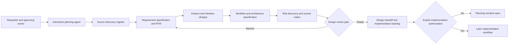

# Spec2Code — Feature Design Catalogue (PLAN-084)

> **Design inventory**, not a claim that proposed behavior is implemented. Source baseline: [feature register F01–F37](../.features.md), [draft specification](../.spec.md), [system RTM](../.traceMatrix.md) and [research register](researchRegister.md). A design option must be explicitly accepted by the responsible owner before it becomes a normative requirement or runtime task.

## 1. Functional domains and dependency map

| Design area | Features and requirements | Observed implementation or specification | Design question and acceptance gap |
| --- | --- | --- | --- |
| **D01 Repository boundary & IO** | F04, F08, F09, F13–F15, F18; NFR-001/002 | `.source/scripts/path_guard.py`, `scope_io.py`, `config_loader.py` | Require POSIX/Windows threat model and sensitive/managed output rules; Windows TOCTOU, ownership and OneDrive test still OPEN |
| **D02 Discovery and architecture evidence** | F01–F03, F02, F25 | `scan_infrastructure.py`, `architecture_tree.py`, `context_router.py` | How to detect stale metadata, untrusted source and heuristic links without treating context indexes as authoritative code |
| **D03 Policy, requirement & agent governance** | F12, F27–F29, F32–F35; NFR-004/005 | `AGENTS.md`, `.agents/.workflow/`, `policy_resolver.py` | Canonical authority by domain, root/nested AGENTS precedence, no approval from policy `READY`; Agents are logical roles |
| **D04 Sessions, attribution and runtime handoff** | F05–F06, F16–F17, F24, F26 | `session_guard.py`, `handoff_store.py` | Preserve source attribution, external drift and exact-session SHA; explicit old-layout migration and no auto-deletion |
| **D05 Workflow integrity / eventual pause** | F30, F36–F37; NFR-006/007 | `workflow_guard.py`, [workflow spec](../.workflow/workflowSpecification.md), [STOP protocol](../.workflow/stopAndHandoff.md) | Correct real-scope gates and invalidation **before** building runtime STOP/RESUME; schema and backward compatibility design needed |
| **D06 Optional Spec Kit integration** | F07, F22 | `speckit_bridge.py`, `.source/integrations/speckit/README.md` | Select real active feature, respect upstream ownership, distinguish CLI vs native agent skills; no silent init/modify |
| **D07 Interfaces, deployment and independent acceptance** | F10–F11, F19–F20, F31, F36 | `mcp_boundary.py`, `.github/workflows/tests.yml`, `docs/INSTALL.md` | No real MCP server; preserve JSON/CLI and installed bundle; verify exact-OS and host policy before release |

Features F21–F23 are expressly non-goals, even if tests or docs discuss their prohibition. This catalogue groups current scope; grouping does not change or create a feature ID.

## 2. Reusable design card template for each new or modified feature

```md
### DES-<stable design ID> — <feature title>
- State: PROPOSED / NEEDS_REVIEW / APPROVED (approval source):
- Requirement / AC: S2C-REQ-..., S2C-AC-..., NFR if any:
- Source claim and owner: SRC-... (revision; observed vs approved):
- Actors and permissions:
- Problem and boundaries:
- Main workflow / alternate / error / STOP behavior:
- Data and interfaces (inputs/outputs, classification, ownership):
- Affected components and compatibility:
- Option A / Option B, trade-offs and decision record:
- Risks and mitigations (RM-..., Rxx):
- Verification design (test idea, NOT an invented test result):
- Unresolved decisions and responsible reviewer:
```

Do not create duplicate requirements by silently declaring a design card authoritative. Approval of architecture never waives host business or security approval.

## 3. Proposed design decisions requiring review

| Decision | Area | Options / proposed direction | State / next evidence |
| --- | --- | --- | --- |
| `DES-084-01` | Planning versus runtime phases | **Separate** nine-stage design lifecycle from existing five-stage implementation workflow; never overload Workflow Guard phases with design-only stages | PROPOSED; document review |
| `DES-084-02` | Risk-driven iteration | Score and reprioritize design risks after each design pass; mitigate largest exposure first in documentation, defer code patch to later authorization | PROPOSED; reviewer validates scale and threshold |
| `DES-084-03` | Design handoff | Stage-end and STOP handoff both carry source revision, decisions, gaps and next reviewer; never close runtime session on design handoff | PROPOSED; reviewer validates approved path/ownership |
| `DES-084-04` | Spec Kit ownership | Keep optional upstream native Spec Kit workflow and source document authority; design S2C adapters rather than fork upstream process | PROPOSED; revalidate upstream version before integration implementation |
| `DES-084-05` | Runtime STOP/RESUME | Treat as a **future feature** requiring journal schema/replay/permission compatibility, not as PLAN-084 coding | BLOCKED pending parent PR #7 P0/P1 repairs and design approval |
| `DES-084-06` | Risk criticality versus score | P0 if L×I≥16, or explicit mandatory security/authorization blocker regardless score | PROPOSED; independent security owner must review |

## 4. Architecture concept — not an implementation diagram



The interactive agent does not autonomously read untrusted data, perform background tasks, change Git or approve itself. Actual runtime modules are separate evidence sources and future implementation targets.

## 5. Feature acceptance checklist

For each risk-bearing design, the reviewer should be able to answer: What approved requirement does this satisfy? Where are its boundaries? What is the happy path and failure behavior? What changes to schema/CLI/permissions would occur? How are sensitive paths preserved? Which exact tests will be needed? How would older sessions and hosts migrate? What is the rollback? Which risk matrix entries remain unmitigated? If any crucial question remains UNKNOWN, the design is not APPROVED_FOR_IMPLEMENTATION.

Source-to-feature mappings and test coverage remain in the [RTM](../.traceMatrix.md). Separate requirement IDs are not added merely because a design area was grouped here.
