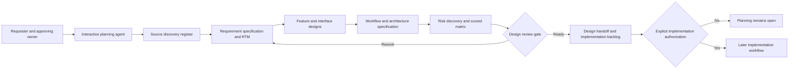

# Spec2Code — Feature Design Catalogue (PLAN-084; integrated PLAN-098)

> **Design inventory**, not a claim that proposed behavior is implemented. Source baseline: [feature register F01–F42](../.features.md), [draft specification](../.spec.md), [system RTM](../.traceMatrix.md) and [research register](researchRegister.md). A design option must be explicitly accepted by the responsible owner before it becomes a normative requirement or runtime task.

## 1. PLAN-098 — AS-IS/TO-BE integration of existing S2C and F43–F64

**Design-only status.** F01–F42 statuses are unchanged (see [feature register](../.features.md)); F38–F42 remain proposed reviews, not real independent worker instances. F43–F64 are 22 **DESIGN_PROPOSED** IDs, not code or accepted tests. This is the **single detailed integration matrix**. H/M/L below are feasibility hypotheses pending actual tests.

| Subsystem | Existing ownership | Proposed integrated capability | Invariant |
| --- | --- | --- | --- |
| S01 Governance | F12,F27–F28,F32–F37; AGENTS/RTM | F46 changes, F58 consolidation, universal lifecycle | Preserve owners and approvals |
| S02 Source graph | F01,F02,F25; scanner, architecture_tree | F43 AST, F45 drift, F55 pipeline, F57 enforcement | Revision evidence, fallback |
| S03 Context | F03,F29; context_router | F49 task routing, F51 compression | Never omit mandatory policy |
| S04 Security | F04,F08–F10,F13–F15,F18,F26,F28; path_guard/scope_io | F44 firewall, F48 fail-safe, F62 supply chain, F64 protection | OS enforcement; P0 still open |
| S05 State | F05,F06,F16,F17,F24,F30,F36,F37; session/handoff/workflow | F46, F58, F64 | Preserve 5-phase machine schema |
| S06 Upstream | F07 Spec Kit bridge; F22 excluded | F53 API, F55 spec mapping | Upstream owns .specify and specs |
| S07 Quality | F20,F31; tests/CI | F47 common gate, F52 sandbox, F57, F61 | Observed results only |
| S08 App/Data | F01/F02, proposed F38–F42 | F53/F55/F56 data/API pipeline | No unreviewed schemas |
| S09 Review | F33 roles; F38–F42 proposed | Static review, DBA F56, FinOps F63 | Independent evidence/dissent |
| S10 Optional runtime | F10 authorization library, F19 deferred | F50 CI/SLM, F54 skills, F59 resilience, F60 flags | Opt-in and bounded |

### 1.1 F43–F64 relation and feasibility matrix

Each row maps a **proposal** into an old feature instead of creating a parallel subsystem. EXTEND=existing component; ADAPTER=optional plugin; NEW=restricted capability. None is implemented by this document.

| ID / proposed function | Existing features | Integration target | Feasibility / priority | Proposed acceptance / caution |
| --- | --- | --- | --- | --- |
| **F43** AST manipulation | F02,F03 | EXTEND source graph with parser adapters | M/P1 | CAS hash, syntax and rollback tests |
| **F44** AI firewall/RBAC | F04,F09,F10,F28 | EXTEND trusted host policy boundary | M/P0 | Deny read/write/execute/delete; prompt alone is insufficient |
| **F45** Semantic Spec–Code drift | F02,F05,F07,F17 | EXTEND source/trace fingerprints | M/P1 | AC+contract diff, provenance, no AI-only approval |
| **F46** Controlled feature evolution | F12,F30,F37 | EXTEND change/impact workflow | H/P1 | Dependency and stale-AC invalidation |
| **F47** Official coding conventions | F20,F31,F32 | EXTEND one quality gate | H/P1 | Per-stack lint and false-positive review |
| **F48** Strict fail-safe | F04,F05,F09,F30 | EXTEND bounded execution/rollback policy | M/P0 | Retry/time/resource caps and cancellation |
| **F49** GPT Web/Codex routing | F03,F29,F33 | EXTEND task and context router | H/P1 | Permission/budget/capability, no hidden delegation |
| **F50** Lightweight CI and SLM | F20,F31,F49 | ADAPTER optional default OFF | M/P2 | Isolated secrets, CPU/memory budget, deterministic fallback |
| **F51** Semantic context compression | F03,F29,F02 | EXTEND context router | M/P1 | Provenance, mandatory-policy recall and benchmark |
| **F52** Dry-run sandbox | F20,F31,F47 | ADAPTER disposable execution | M/P1 | Untrusted code isolated; bounded self-repair |
| **F53** Bidirectional API contract sync | F07,F02 | ADAPTER OpenAPI/DTO mapping | M/P2 | Per-API authority, breaking-change checks |
| **F54** Skill API/gateway | F10,F07 | EXTEND capability registry/adapters | M/P2 | Discover/invoke/cancel with scoped permission |
| **F55** Source→SPEC→ERD→DB→API→CODE | F01,F02,F07,F25 | NEW bounded pipeline planner reusing graph | M/P1 | No inference of unapproved business rules |
| **F56** DBA Guard and reviewer | F38–F42,F47 | EXTEND shared static/review gate | M/P1 | N+1/index/tracking context-dependent |
| **F57** Architecture enforcer | F02,F30,F47 | EXTEND source graph + quality gate | M/P0 | Host-approved layer rules and indirect bypass tests |
| **F58** SAFE cleanup/knowledge merge | F06,F14,F24,F26 | EXTEND ownership/retention handoff | M/P1 | No deletion of unowned/active/legacy/evidence |
| **F59** Cloud-native resilience | F48,F47,F50 | ADAPTER deployment profiles | M/P2 | Stateless durable behavior; idempotent bounded retries |
| **F60** Feature flags/dark launch | F46,F52,F59 | ADAPTER at feature boundary | M/P2 | Canary/telemetry/kill switch; rollback latency not guaranteed |
| **F61** Mutation testing | F47,F52,F42 | ADAPTER inside same quality gate | M/P2 | Equivalent mutants and resource budget |
| **F62** Dependency security | F44,F47,F50 | EXTEND supply-chain quality gate | H/P0 | Registry, advisory, license, lockfile and exception |
| **F63** AI FinOps profiler | F38–F42,F50,F56 | EXTEND reviewer + optional price adapter | M/P2 | Workload/region/time/price evidence, not AST-only dollar claims |
| **F64** Controlled self-evolution | F44,F48,F52,F57,F58,F61 | NEW restricted mode after external security gates | L/P1 design | Z0/Z1 denial, completion >95%, line+branch >95%, 100% mandatory AC, human approval |

### 1.2 Integration decisions — merge shared mechanisms

| Decision | Reuse/merge rather than append | Contract and fail-safe |
| --- | --- | --- |
| DEC-098-01 | ONE quality gate F47 serving F56/F57/F61/F62 | Check(scope,revision,rule) → finding(severity,evidence,status); P0 not voted away |
| DEC-098-02 | ONE context router F03/F29 serving F49/F51/SLM | Source references and mandatory policy immutable under compression |
| DEC-098-03 | ONE proposed F38–F42 reviewer protocol for static/QA/DBA/FinOps | Evidence-first raw findings, role/persona weights, dissent; role-lenses ≠ independent workers |
| DEC-098-04 | ONE source+trace graph F02/F12 supporting F43/F45/F53/F55/F57 | Spec/API owner decisions, no implicit sync override |
| DEC-098-05 | ONE trusted F04/F09/F10/F28 scope/permission boundary for F44/F48/F58/F64 | Deny-by-default; OS/host controls outside the model |
| DEC-098-06 | ONE F05/F06/F30/F37 session and handoff record for F46/F58 | STOP ≠ CLOSE; stale evidence invalidated |
| DEC-098-07 | Optional adapters only: F50/F52/F53/F54/F59/F60 | No compulsory new daemon, DB, vector engine, GPU or MCP server |
| DEC-098-08 | Keep excluded F21–F23 excluded | No unattended shell/Git, vendored Spec Kit or hardcoded domains |

**Feature workspace (design only):** `s2c/features/<feature-id>/spec/{html,erd,db,api,code}/`, `existing/{html,erd,db,api,code}/`, `plan2code/{html,erd,db,api,code,tests}/` and `manifest.json`. `spec` references the approved source; `existing` is read-only evidence; `plan2code` is staging. Existing `s2c/` already stores architecture indexes: require path collision/ownership and migration review **before creation**. F58 SAFE mode is only a proposed policy; **no automatic cleanup in this planning task**.

### 1.3 Critical path, measurable gates and ordering

M0 source/status/ID/BRD/RTM/risk reconciliation → independent **A.1** → explicit **B** → M1 repair OS/Path Guard/workflow P0 → M2 trace/retention/ownership/versioning → M3 shared static/AST/context/review pilots → M4 optional CI/SLM/API/DB/cloud/FinOps adapters and **B.1** → M5 release owner decision. F64 is the last isolated capability. Every phase/task uses the [universal nine-stage process](../.workflow/workflowSpecification.md#2-universal-nine-stage-execution-contract-plan-098). Source runtime/host testing and independent approval remain NOT_RUN.


## 2. Reusable design card template for each new or modified feature

```md
### DES-<stable design ID> — <feature title>
- State: PROPOSED / NEEDS_REVIEW / APPROVED (approval source):
- Requirement / AC: S2C-REQ-..., S2C-AC-..., NFR if any:
- Source claim and owner: SRC-... (revision; observed vs approved):
- Actors and permissions:
- Problem and boundaries:
- Main workflow / alternate / error / STOP behavior:
- Data and interfaces (inputs/outputs, classification, ownership):
- Affected components and compatibility:
- Option A / Option B, trade-offs and decision record:
- Risks and mitigations (RM-..., Rxx):
- Verification design (test idea, NOT an invented test result):
- Unresolved decisions and responsible reviewer:
```

Do not create duplicate requirements by silently declaring a design card authoritative. Approval of architecture never waives host business or security approval.

## 3. Proposed design decisions requiring review

| Decision | Area | Options / proposed direction | State / next evidence |
| --- | --- | --- | --- |
| `DES-084-01` | Planning versus runtime phases | **Separate** nine-stage design lifecycle from existing five-stage implementation workflow; never overload Workflow Guard phases with design-only stages | PROPOSED; document review |
| `DES-084-02` | Risk-driven iteration | Score and reprioritize design risks after each design pass; mitigate largest exposure first in documentation, defer code patch to later authorization | PROPOSED; reviewer validates scale and threshold |
| `DES-084-03` | Design handoff | Stage-end and STOP handoff both carry source revision, decisions, gaps and next reviewer; never close runtime session on design handoff | PROPOSED; reviewer validates approved path/ownership |
| `DES-084-04` | Spec Kit ownership | Keep optional upstream native Spec Kit workflow and source document authority; design S2C adapters rather than fork upstream process | PROPOSED; revalidate upstream version before integration implementation |
| `DES-084-05` | Runtime STOP/RESUME | Treat as a **future feature** requiring journal schema/replay/permission compatibility, not as PLAN-084 coding | BLOCKED pending parent PR #7 P0/P1 repairs and design approval |
| `DES-084-06` | Risk criticality versus score | P0 if L×I≥16, or explicit mandatory security/authorization blocker regardless score | PROPOSED; independent security owner must review |

## 4. Architecture concept — not an implementation diagram



The interactive agent does not autonomously read untrusted data, perform background tasks, change Git or approve itself. Actual runtime modules are separate evidence sources and future implementation targets.

## 5. Feature acceptance checklist

For each risk-bearing design, the reviewer should be able to answer: What approved requirement does this satisfy? Where are its boundaries? What is the happy path and failure behavior? What changes to schema/CLI/permissions would occur? How are sensitive paths preserved? Which exact tests will be needed? How would older sessions and hosts migrate? What is the rollback? Which risk matrix entries remain unmitigated? If any crucial question remains UNKNOWN, the design is not APPROVED_FOR_IMPLEMENTATION.

Source-to-feature mappings and test coverage remain in the [RTM](../.traceMatrix.md). Separate requirement IDs are not added merely because a design area was grouped here.

## 6. PLAN-086: conservative stacks and requested exceptions

For every design affecting a language/runtime/package, PowerShell script/module, SQL server/driver/dialect/migration, .NET dependency, CI toolchain or project structure in **S2C itself or the integrated host**, add a [technology assessment](technologyAssessmentTemplate.md) and compare to the [cross-stack support/adoption policy](technologyVersionPolicy.md). Prefer currently supported mature versions and common maintainable structures by default. Preserve the host's existing approved architecture unless changed within scope. SQL requires **a named DBMS and actual version**, not one universal 'SQL version'. Current S2C Python tests against a newer interpreter do not themselves approve that interpreter as a minimum deployment version.

If the **user explicitly requires** a version or structure contrary to that default, attach an [override record](technologyOverrideTemplate.md) with exact codebase scope, user request, security/OS/dependency evidence, alternatives, test strategy, rollback and permission status. For a supported newly GA stable major, the user may override conservatism as a design preference with documented risk. EOL/preview/high-risk technology needs additional safety/host owner review; never silently change host architecture or claim a design approval has implemented code. Design IDs `DES-086-01` (supported default) and `DES-086-02` (common layout), `DES-086-03` (bounded user override) are PROPOSED, not implemented.


## 7. PLAN-088 — Integrated reviewer service design cards (draft)

These design cards elaborate the single [BRD/architecture/roadmap](../.spec.md#12-weighted-multi-agent-review-requirements-and-design), not a parallel requirements system. None has A.1 approval or source implementation.

| Design ID | BR / F | Input / output interface | Preconditions, adverse cases and rollback |
| --- | --- | --- | --- |
| DES-088-01 | BR-017 / F38 | source snapshot + classifier, role/persona/weight policies, requested n and budget → selected reviewer manifest | Enforce mandatory coverage, max workers, normalized weights, bounded scope; unavailable role marks GAP/BLOCK; revert planner-only version |
| DES-088-02 | BR-018 / F39 | frozen snapshot, bounded independent instructions and reviewer persona → evidence-grounded finding set | No peer-result leakage, secrets or made-up locator; output PARTIAL/UNVERIFIED when unsupported; preserve old reports |
| DES-088-03 | BR-019 / F40 | immutable raw finding sets → synthesis with agreement, duplicate mapping, minority dissent, priority and open questions | P0 blocker or authority violation cannot be voted away; synthesis cannot approve; re-run new revision without overwriting old |
| DES-088-04 | BR-020 / F41 | immutable manifest + worker outputs + scope/policy/source fingerprints → linked risk/RTM/handoff artifacts | STOP/RESUME and drift require fresh checks; non-owned path collision BLOCK; no unapproved host writes |
| DES-088-05 | BR-021 / F42 | AC-REV scenarios, exact-head host tests, human reviewer identity → evidence-bound A.1/B.1 decision | Adversarial prompt injection, stale policy, n=1, quota and minority dissent included; FAIL/BLOCK retains prior evidence |

Runtime integration is an optional bounded service **after** M1/M2 safety and A.1/B authorization. It may reuse policy, context, scope and handoff interfaces; do not refactor existing guards or invent a persistent service merely to support this diagram. A Python planner, review config or artifact namespace is still a proposal subject to compatibility, owner/collision checks and migration review. If the host offers no multi-agent execution, use clearly labeled sequential role-lens analysis with documented independence limitations.

Data and severity scoring stay in the master Sections 12–13; trace belongs to [RTM Section I](../.traceMatrix.md#i-plan-088--unified-review-service-requirement-and-evidence-crosswalk-draft); risk numbers belong to [RM-025..033](../.riskMatrix.md#9-plan-088--weighted-review-before--action--after-and-candidate-scored-matrix). Do not duplicate these definitions inside an alternate config or separate BRD.
