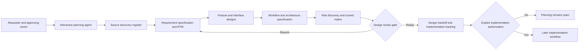

# Spec2Code — Feature Design Catalogue (PLAN-084; integrated PLAN-098)

> **Design inventory**, not a claim that proposed behavior is implemented. Source baseline: [feature register F01–F42](../.features.md), [draft specification](../.spec.md), [system RTM](../.traceMatrix.md) and [research register](researchRegister.md). A design option must be explicitly accepted by the responsible owner before it becomes a normative requirement or runtime task.

## 1. PLAN-098 — AS-IS/TO-BE integration of existing S2C and F43–F64

**Design-only status.** F01–F42 statuses are unchanged (see [feature register](../.features.md)); F38–F42 remain proposed reviews, not real independent worker instances. F43–F64 are 22 **DESIGN_PROPOSED** IDs, not code or accepted tests. This is the **single detailed integration matrix**. H/M/L below are feasibility hypotheses pending actual tests.

| Subsystem | Existing ownership | Proposed integrated capability | Invariant |
| --- | --- | --- | --- |
| S01 Governance | F12,F27–F28,F32–F37; AGENTS/RTM | F46 changes, F58 consolidation, universal lifecycle | Preserve owners and approvals |
| S02 Source graph | F01,F02,F25; scanner, architecture_tree | F43 AST, F45 drift, F55 pipeline, F57 enforcement | Revision evidence, fallback |
| S03 Context | F03,F29; context_router | F49 task routing, F51 compression | Never omit mandatory policy |
| S04 Security | F04,F08–F10,F13–F15,F18,F26,F28; path_guard/scope_io | F44 firewall, F48 fail-safe, F62 supply chain, F64 protection | OS enforcement; P0 still open |
| S05 State | F05,F06,F16,F17,F24,F30,F36,F37; session/handoff/workflow | F46, F58, F64 | Preserve 5-phase machine schema |
| S06 Upstream | F07 Spec Kit bridge; F22 excluded | F53 API, F55 spec mapping | Upstream owns .specify and specs |
| S07 Quality | F20,F31; tests/CI | F47 common gate, F52 sandbox, F57, F61 | Observed results only |
| S08 App/Data | F01/F02, proposed F38–F42 | F53/F55/F56 data/API pipeline | No unreviewed schemas |
| S09 Review | F33 roles; F38–F42 proposed | Static review, DBA F56, FinOps F63 | Independent evidence/dissent |
| S10 Optional runtime | F10 authorization library, F19 deferred | F50 CI/SLM, F54 skills, F59 resilience, F60 flags | Opt-in and bounded |

### 1.1 F43–F64 relation and feasibility matrix

Each row maps a **proposal** into an old feature instead of creating a parallel subsystem. EXTEND=existing component; ADAPTER=optional plugin; NEW=restricted capability. None is implemented by this document.

| ID / proposed function | Existing features | Integration target | Feasibility / priority | Proposed acceptance / caution |
| --- | --- | --- | --- | --- |
| **F43** AST manipulation | F02,F03 | EXTEND source graph with parser adapters | M/P1 | CAS hash, syntax and rollback tests |
| **F44** AI firewall/RBAC | F04,F09,F10,F28 | EXTEND trusted host policy boundary | M/P0 | Deny read/write/execute/delete; prompt alone is insufficient |
| **F45** Semantic Spec–Code drift | F02,F05,F07,F17 | EXTEND source/trace fingerprints | M/P1 | AC+contract diff, provenance, no AI-only approval |
| **F46** Controlled feature evolution | F12,F30,F37 | EXTEND change/impact workflow | H/P1 | Dependency and stale-AC invalidation |
| **F47** Official coding conventions | F20,F31,F32 | EXTEND one quality gate | H/P1 | Per-stack lint and false-positive review |
| **F48** Strict fail-safe | F04,F05,F09,F30 | EXTEND bounded execution/rollback policy | M/P0 | Retry/time/resource caps and cancellation |
| **F49** GPT Web/Codex routing | F03,F29,F33 | EXTEND task and context router | H/P1 | Permission/budget/capability, no hidden delegation |
| **F50** Lightweight CI and SLM | F20,F31,F49 | ADAPTER optional default OFF | M/P2 | Isolated secrets, CPU/memory budget, deterministic fallback |
| **F51** Semantic context compression | F03,F29,F02 | EXTEND context router | M/P1 | Provenance, mandatory-policy recall and benchmark |
| **F52** Dry-run sandbox | F20,F31,F47 | ADAPTER disposable execution | M/P1 | Untrusted code isolated; bounded self-repair |
| **F53** Bidirectional API contract sync | F07,F02 | ADAPTER OpenAPI/DTO mapping | M/P2 | Per-API authority, breaking-change checks |
| **F54** Skill API/gateway | F10,F07 | EXTEND capability registry/adapters | M/P2 | Discover/invoke/cancel with scoped permission |
| **F55** Source→SPEC→ERD→DB→API→CODE | F01,F02,F07,F25 | NEW bounded pipeline planner reusing graph | M/P1 | No inference of unapproved business rules |
| **F56** DBA Guard and reviewer | F38–F42,F47 | EXTEND shared static/review gate | M/P1 | N+1/index/tracking context-dependent |
| **F57** Architecture enforcer | F02,F30,F47 | EXTEND source graph + quality gate | M/P0 | Host-approved layer rules and indirect bypass tests |
| **F58** SAFE cleanup/knowledge merge | F06,F14,F24,F26 | EXTEND ownership/retention handoff | M/P1 | No deletion of unowned/active/legacy/evidence |
| **F59** Cloud-native resilience | F48,F47,F50 | ADAPTER deployment profiles | M/P2 | Stateless durable behavior; idempotent bounded retries |
| **F60** Feature flags/dark launch | F46,F52,F59 | ADAPTER at feature boundary | M/P2 | Canary/telemetry/kill switch; rollback latency not guaranteed |
| **F61** Mutation testing | F47,F52,F42 | ADAPTER inside same quality gate | M/P2 | Equivalent mutants and resource budget |
| **F62** Dependency security | F44,F47,F50 | EXTEND supply-chain quality gate | H/P0 | Registry, advisory, license, lockfile and exception |
| **F63** AI FinOps profiler | F38–F42,F50,F56 | EXTEND reviewer + optional price adapter | M/P2 | Workload/region/time/price evidence, not AST-only dollar claims |
| **F64** Controlled self-evolution | F44,F48,F52,F57,F58,F61 | NEW restricted mode after external security gates | L/P1 design | Z0/Z1 denial, completion >95%, line+branch >95%, 100% mandatory AC, human approval |

### 1.2 Integration decisions — merge shared mechanisms

| Decision | Reuse/merge rather than append | Contract and fail-safe |
| --- | --- | --- |
| DEC-098-01 | ONE quality gate F47 serving F56/F57/F61/F62 | Check(scope,revision,rule) → finding(severity,evidence,status); P0 not voted away |
| DEC-098-02 | ONE context router F03/F29 serving F49/F51/SLM | Source references and mandatory policy immutable under compression |
| DEC-098-03 | ONE proposed F38–F42 reviewer protocol for static/QA/DBA/FinOps | Evidence-first raw findings, role/persona weights, dissent; role-lenses ≠ independent workers |
| DEC-098-04 | ONE source+trace graph F02/F12 supporting F43/F45/F53/F55/F57 | Spec/API owner decisions, no implicit sync override |
| DEC-098-05 | ONE trusted F04/F09/F10/F28 scope/permission boundary for F44/F48/F58/F64 | Deny-by-default; OS/host controls outside the model |
| DEC-098-06 | ONE F05/F06/F30/F37 session and handoff record for F46/F58 | STOP ≠ CLOSE; stale evidence invalidated |
| DEC-098-07 | Optional adapters only: F50/F52/F53/F54/F59/F60 | No compulsory new daemon, DB, vector engine, GPU or MCP server |
| DEC-098-08 | Keep excluded F21–F23 excluded | No unattended shell/Git, vendored Spec Kit or hardcoded domains |

**Feature workspace (design only):** `s2c/features/<feature-id>/spec/{html,erd,db,api,code}/`, `existing/{html,erd,db,api,code}/`, `plan2code/{html,erd,db,api,code,tests}/` and `manifest.json`. `spec` references the approved source; `existing` is read-only evidence; `plan2code` is staging. Existing `s2c/` already stores architecture indexes: require path collision/ownership and migration review **before creation**. F58 SAFE mode is only a proposed policy; **no automatic cleanup in this planning task**.

### 1.3 Critical path, measurable gates and ordering

M0 source/status/ID/BRD/RTM/risk reconciliation → independent **A.1** → explicit **B** → M1 repair OS/Path Guard/workflow P0 → M2 trace/retention/ownership/versioning → M3 shared static/AST/context/review pilots → M4 optional CI/SLM/API/DB/cloud/FinOps adapters and **B.1** → M5 release owner decision. F64 is the last isolated capability. Every phase/task uses the [universal nine-stage process](../.workflow/workflowSpecification.md#2-universal-nine-stage-execution-contract-plan-098). Source runtime/host testing and independent approval remain NOT_RUN.


## 2. Reusable design card template for each new or modified feature

```md
### DES-<stable design ID> — <feature title>
- State: PROPOSED / NEEDS_REVIEW / APPROVED (approval source):
- Requirement / AC: S2C-REQ-..., S2C-AC-..., NFR if any:
- Source claim and owner: SRC-... (revision; observed vs approved):
- Actors and permissions:
- Problem and boundaries:
- Main workflow / alternate / error / STOP behavior:
- Data and interfaces (inputs/outputs, classification, ownership):
- Affected components and compatibility:
- Option A / Option B, trade-offs and decision record:
- Risks and mitigations (RM-..., Rxx):
- Verification design (test idea, NOT an invented test result):
- Unresolved decisions and responsible reviewer:
```

Do not create duplicate requirements by silently declaring a design card authoritative. Approval of architecture never waives host business or security approval.

## 3. Proposed design decisions requiring review

| Decision | Area | Options / proposed direction | State / next evidence |
| --- | --- | --- | --- |
| `DES-084-01` | Planning versus runtime phases | **Separate** nine-stage design lifecycle from existing five-stage implementation workflow; never overload Workflow Guard phases with design-only stages | PROPOSED; document review |
| `DES-084-02` | Risk-driven iteration | Score and reprioritize design risks after each design pass; mitigate largest exposure first in documentation, defer code patch to later authorization | PROPOSED; reviewer validates scale and threshold |
| `DES-084-03` | Design handoff | Stage-end and STOP handoff both carry source revision, decisions, gaps and next reviewer; never close runtime session on design handoff | PROPOSED; reviewer validates approved path/ownership |
| `DES-084-04` | Spec Kit ownership | Keep optional upstream native Spec Kit workflow and source document authority; design S2C adapters rather than fork upstream process | PROPOSED; revalidate upstream version before integration implementation |
| `DES-084-05` | Runtime STOP/RESUME | Treat as a **future feature** requiring journal schema/replay/permission compatibility, not as PLAN-084 coding | BLOCKED pending parent PR #7 P0/P1 repairs and design approval |
| `DES-084-06` | Risk criticality versus score | P0 if L×I≥16, or explicit mandatory security/authorization blocker regardless score | PROPOSED; independent security owner must review |

## 4. Architecture concept — not an implementation diagram



The interactive agent does not autonomously read untrusted data, perform background tasks, change Git or approve itself. Actual runtime modules are separate evidence sources and future implementation targets.

## 5. Feature acceptance checklist

For each risk-bearing design, the reviewer should be able to answer: What approved requirement does this satisfy? Where are its boundaries? What is the happy path and failure behavior? What changes to schema/CLI/permissions would occur? How are sensitive paths preserved? Which exact tests will be needed? How would older sessions and hosts migrate? What is the rollback? Which risk matrix entries remain unmitigated? If any crucial question remains UNKNOWN, the design is not APPROVED_FOR_IMPLEMENTATION.

Source-to-feature mappings and test coverage remain in the [RTM](../.traceMatrix.md). Separate requirement IDs are not added merely because a design area was grouped here.

## 6. PLAN-086: conservative stacks and requested exceptions

For every design affecting a language/runtime/package, PowerShell script/module, SQL server/driver/dialect/migration, .NET dependency, CI toolchain or project structure in **S2C itself or the integrated host**, add a [technology assessment](technologyAssessmentTemplate.md) and compare to the [cross-stack support/adoption policy](technologyVersionPolicy.md). Prefer currently supported mature versions and common maintainable structures by default. Preserve the host's existing approved architecture unless changed within scope. SQL requires **a named DBMS and actual version**, not one universal 'SQL version'. Current S2C Python tests against a newer interpreter do not themselves approve that interpreter as a minimum deployment version.

If the **user explicitly requires** a version or structure contrary to that default, attach an [override record](technologyOverrideTemplate.md) with exact codebase scope, user request, security/OS/dependency evidence, alternatives, test strategy, rollback and permission status. For a supported newly GA stable major, the user may override conservatism as a design preference with documented risk. EOL/preview/high-risk technology needs additional safety/host owner review; never silently change host architecture or claim a design approval has implemented code. Design IDs `DES-086-01` (supported default) and `DES-086-02` (common layout), `DES-086-03` (bounded user override) are PROPOSED, not implemented.


## 7. PLAN-088 — Integrated reviewer service design cards (draft)

These design cards elaborate the single [BRD/architecture/roadmap](../.spec.md#12-weighted-multi-agent-review-requirements-and-design), not a parallel requirements system. None has A.1 approval or source implementation.

| Design ID | BR / F | Input / output interface | Preconditions, adverse cases and rollback |
| --- | --- | --- | --- |
| DES-088-01 | BR-017 / F38 | source snapshot + classifier, role/persona/weight policies, requested n and budget → selected reviewer manifest | Enforce mandatory coverage, max workers, normalized weights, bounded scope; unavailable role marks GAP/BLOCK; revert planner-only version |
| DES-088-02 | BR-018 / F39 | frozen snapshot, bounded independent instructions and reviewer persona → evidence-grounded finding set | No peer-result leakage, secrets or made-up locator; output PARTIAL/UNVERIFIED when unsupported; preserve old reports |
| DES-088-03 | BR-019 / F40 | immutable raw finding sets → synthesis with agreement, duplicate mapping, minority dissent, priority and open questions | P0 blocker or authority violation cannot be voted away; synthesis cannot approve; re-run new revision without overwriting old |
| DES-088-04 | BR-020 / F41 | immutable manifest + worker outputs + scope/policy/source fingerprints → linked risk/RTM/handoff artifacts | STOP/RESUME and drift require fresh checks; non-owned path collision BLOCK; no unapproved host writes |
| DES-088-05 | BR-021 / F42 | AC-REV scenarios, exact-head host tests, human reviewer identity → evidence-bound A.1/B.1 decision | Adversarial prompt injection, stale policy, n=1, quota and minority dissent included; FAIL/BLOCK retains prior evidence |

Runtime integration is an optional bounded service **after** M1/M2 safety and A.1/B authorization. It may reuse policy, context, scope and handoff interfaces; do not refactor existing guards or invent a persistent service merely to support this diagram. A Python planner, review config or artifact namespace is still a proposal subject to compatibility, owner/collision checks and migration review. If the host offers no multi-agent execution, use clearly labeled sequential role-lens analysis with documented independence limitations.

Data and severity scoring stay in the master Sections 12–13; trace belongs to [RTM Section I](../.traceMatrix.md#i-plan-088--unified-review-service-requirement-and-evidence-crosswalk-draft); risk numbers belong to [RM-025..033](../.riskMatrix.md#9-plan-088--weighted-review-before--action--after-and-candidate-scored-matrix). Do not duplicate these definitions inside an alternate config or separate BRD.


## 8. PLAN-099 — Gap closures integrated into existing functions (DESIGN_PROPOSED)

**Owner:** [unified BRD/architecture and construction roadmap](../.spec.md#24-plan-099--construction-layer-roadmap-and-bounded-parallel-execution). These six proposals are **integration upgrades**, not F65–F70 or replacement subsystems. This design table alone owns individual interface details; [RTM](../.traceMatrix.md#q-plan-099--six-gap-closure-acceptance-crosswalk-design-only) links planned checks, [risk matrix](../.riskMatrix.md#19-plan-099--parallel-execution-and-integration-risks) owns their risks.

| Gap closure / design ID | Reuse/extend (no duplicate engine) | Producer → consumer and minimum contract | Integration test and failure behavior |
| --- | --- | --- | --- |
| DES-099-A Integration Contract Registry | **EXTEND F12/F46/F53/F54** and existing RTM/governance, not a separate specification authority | Approved interface owner + versioned producer/consumer IDs → `contractId, schemaVersion, input, expectedOutput, preconditions, postconditions, permissions, errors, timeout, provenance, compatibility, rollback` | Schema compatibility + missing owner/version + incompatible consumer; fail `NEEDS_REVIEW` before writes |
| DES-099-B Cross-Feature Integration Testing | **EXTEND F31/F42/F47/F52**, common Quality Gate; not another runner | Contract+source snapshot+safe fixtures → linked SPEC→CONTEXT→TASK→STATIC REVIEW→TEST→VERIFY→HANDOFF evidence with positive/negative/STOP/drift paths | Verify every edge, orphan and partial failure; exact-SHA results; never treat designed cases as PASS |
| DES-099-C Trusted Execution Boundary | **HARDEN F04/F09/F10/F28/F44** and apply to F64; external host/OS/CI policy owns enforcement | Immutable approved policy + source+task identity+read/write sets+zone Z0–Z4 → allow/deny with reason, expiry and audit | Deny protected-core direct AND indirect changes, path/junction/TOCTOU, secret-bearing jobs; model cannot grant rights |
| DES-099-D Evidence and Provenance Graph | **EXTEND F05/F12/F17/F41/F45/F58**, use F02 graph/RTM; no new canonical data store | Requirement/AC, source SHA, config/Spec Kit revision, task, output, test, reviewer → append-only typed edges and freshness status | Stale source invalidates dependent PASS, tampering/ambiguous ownership blocks, preserves original raw evidence |
| DES-099-E Change Impact Propagation | **EXTEND F02/F17/F46/F55/F57**, shared graph and Workflow Guard | Changed file/contract/revision → direct/transitive dependencies + affected requirements, worker scopes, tests, risk, cache invalidations | Cyclic/unknown edge fails conservatively; selective rerun with required regression and no silent skipped impact |
| DES-099-F Readiness & Quality Scorecard | **EXTEND F20/F42/F47/F61/F64**, existing A.1/B.1 gates; no self-approval engine | Current AC/RTM + exact-head test/gate evidence → per-dimension completion, coverage and `BLOCK/REVIEW/READY_FOR_OWNER` recommendation | Unknown/unrun != PASS, P0/security veto cannot be offset by weighted score; human approval distinct |

**Design contracts (not implementation):** each integration edge declares stable producer and consumer, versioned data contract, expected output, ownership, safety classification, retry/idempotency, source revision, backward compatibility and explicit test scenario. A feature label or diagram edge without that contract is `UNSPECIFIED`, not integration-ready. Contract records live in existing canonical Markdown/RTM until a schema adapter is approved. No unreviewed live API/database is introduced. Measured completion is evidence-based, not inferred from Fxx status.

### 8.1 Bounded parallel work and worker compatibility

Parallelism is a **scheduling policy over a dependency DAG**, not an extra unrestricted executor. Reuse F33 and proposed F38–F42 as role/profile selection plus F05/F06 task evidence; F44/F48/F52 as independently enforced access and resource controls. A `WorkUnit` proposal contains `unitId, phase, taskId, parentStage, dependencyIds, sourceSHA, readSet, writeSet, impactSet, zone, requiredCapabilities, budget, deadline, expectedOutput, validationPlan`. A `WorkerResult` carries `unitId, observedSourceSHA, artifactRefs, tests, findings, changes, actualBudget, status, error, handoffRef`. Worker personas adjust review focus only; they cannot elevate authorization or bypass a P0.

| Work unit | Parallel policy | Integration barrier |
| --- | --- | --- |
| Read-only source discovery, research, doc/static review | **ALLOW** after pinned snapshot and permitted reads; n depends on host capabilities and budget | Dedup findings, preserve dissent and sources |
| Independent feature adapters or tests with disjoint *write+impact* sets | **CONDITIONAL**, isolated worktrees/artifacts, versioned contracts | One trusted integrator checks unchanged base SHA, resolves conflicts, reruns impacted quality/security tests |
| Shared RTM/master/AGENTS, Workflow Guard, Path Guard, schema migration and Protected Core | **SERIAL_OWNER**, parallel reviewers/readers only | Owner-mediated change and independent security gate |
| Self-evolution F64, real deployment, release, cleanup deletion, role approval | **NO AUTONOMOUS PARALLEL WRITE** | Explicit human authorization; Z0/Z1 prohibited for self-change |

Dispatch only `READY` DAG nodes with all prerequisite gates met; prohibit overlapping `writeSet` **or transitive `impactSet`**, stale SHA and resource-budget oversubscription. Locks/leases have owner, scope, TTL, cancellation and failure recovery; **lock files alone are not OS isolation**. Multi-agent workers require supported real execution; same-model sequential lenses must be marked `SEQUENTIAL_NONINDEPENDENT`. True CPU parallel work may use isolated processes/CI jobs; Python threads alone do not imply CPU inference acceleration.

### 8.2 Design acceptance and conservative fallback

The parallel pilot must compare serial vs bounded n-worker execution for correctness, deterministic trace, total wall-clock time, total tokens/CI minutes, contention and failure recovery. No unmeasured speedup promise. Cancellation, timeout, lost worker, source drift, collision, failed gate or risk escalation must stop dependent work and preserve a resumable handoff. For an unavailable worker/sandbox, use serial or `BLOCKED` per policy, never silently weaken a mandatory check. Every task/phase still records the [nine universal stages](../.workflow/workflowSpecification.md#2-universal-nine-stage-execution-contract-plan-098), even if distinct independent subtasks run concurrently.

## 9. PLAN-101 — Provider contract and AutoRun boundary

This design extends [master Section 26](../.spec.md#26-plan-101--codexgeminiantigravity-documentation-integration-candidate), reusing F03/F04/F05/F07/F09/F10/F17/F19/F21/F30/F33/F38–F42/F44/F48/F52/F64, not a duplicate orchestrator. `.source/scripts/mcp_boundary.py` is a permission *library*, **not an installed MCP server**; `.source/.config/mcp.json` is not Google provider authentication.

| Boundary | Proposed input/output | Fail-safe obligation |
| --- | --- | --- |
| Requester → Controller | task ID, approved paths, source SHA, budget, mode → scoped plan | Phase-A doc consent does not authorize B/shell/network |
| Controller → Codex | actual CLI flag inventory, OS sandbox, allowed docs → exit/stderr/diff | One writer, no untested flag fallback, independent Path Guard |
| Controller → MCP → Gemini/AGY | minimal redacted read-only source manifest/hash, time/token cap → findings, unreviewed paths, provider status | No automatic `npx -y` install, secrets, shell delegation or fictitious independent review |
| Integrator → Git | approved Markdown, exact expected branch SHA → nonforced commit + readback | Reject stale parent, don't touch nine existing local changed files |
| Reviewer → A.1 | exact Git+Google pair, tests, RTM, P0 risks → signed disposition | Only actual accountable independent review can decide A.1 |

**Candidate protocol, not deployed JSON:** request `taskId, providerId, adapterVersion, operation(analyze|review), inputGitSha, sourceManifest(path,sha,range,dataClass), allowedTools, policyId, maxCalls, tokenBudget, deadline, approvalRef`; response `status(READY|DEGRADED|BLOCKED|UNAVAILABLE), sourceSha, providerVersion, findings(id,source,evidence,confidence,severity), unreviewedPaths, usage, errorCode, auditRef`. Reject malformed/extra-privilege response, stale source and model claims of human approval.

**Modes:** Manual prompts each operation; Safe Auto limits vetted documentation writes; Sandbox Auto is an isolated, owner-approved future build/test workflow; Full Auto still requires sandbox, explicit authorization and strict budgets (not YOLO). No approval for CLI/runtime expansion is conferred by documenting them. A Codex MCP `tool_timeout_sec` does not itself enforce subprocess or whole-session deadlines. On tool/auth/quota failure report BLOCKED/DEGRADED and preserve handoff, never skip a mandatory gate.

## 10. PLAN-102 — Architecture Decision Records for A.1 disposition

These are **proposed decisions** linked to the existing [master Section 27](../.spec.md#27-plan-102--documentation-authoring-closure-and-bounded-implementation-blueprint), not approved ADRs or new runtime modules. Each alternative must be reconsidered under actual host/tool evidence. `Proposed` is a drafting recommendation only.

| ADR | Decision under review | Proposed default and rationale | Alternative/rejection condition | Owner / status |
| --- | --- | --- | --- | --- |
| ADR-102-01 | Single source of requirements | Git `.agents/.spec.md` canonical, Google summary mirror; preserve exact pair/drift ledger | Dual normative BRD rejected due split approval provenance | Product/document owner / PROPOSED |
| ADR-102-02 | Agent integration shape | Optional provider adapter, no required daemon or MCP server in portable S2C skill | Native always-on service requires host threat model, secrets and migration design | Host/security/architect / PROPOSED |
| ADR-102-03 | Write authority and concurrency | Single integrator + bounded read-only workers, source SHA and protected writeSet | Parallel writes only after independent conflict/OS isolation tests | Security/integration / PROPOSED |
| ADR-102-04 | Spec Kit ownership | Upstream owns `.specify/` and `specs/`; status/preview read-only, native mutation gated | Fork/vendor official CLI rejected without approved compatibility case | Spec Kit integration owner / PROPOSED |
| ADR-102-05 | Execution mode | Manual or Safe Auto for documents, sandboxed constrained modes only after explicit approval | Unrestricted full-auto/YOLO rejected; observed CLI flag unsupported on prior host | Host/security operator / PROPOSED |
| ADR-102-06 | Evidence/state compatibility | Preserve five current machine phases, model nine-stage work contract separately; version proposed envelopes | New state machine migration only after approved B and legacy-state migration tests | Architecture/QA / PROPOSED |
| ADR-102-07 | Technology support | Maintainer-official conventions and mature supported runtimes; explicit user override recorded | Preview/EOL prohibited by default; new stable major requires explicit owner risk decision | Technology/host owner / PROPOSED |
| ADR-102-08 | Review independence | Distinguish different provider sessions, separated actors and accountable human A.1 | Same-model role lenses treated as one correlated author review | QA/security owner / PROPOSED |

**Interface ownership matrix:** Context Router produces a source-bound minimal manifest; Policy Resolver/Path Guard gate scope; Workflow Guard governs implemented five-phase transitions; Handoff Store retains source/session evidence; optional provider adapter returns untrusted structured observations; Review Aggregator proposes synthesis without approval authority; human review gate records an independent decision. Contract mutations, ownership of storage paths and external-provider secrets must remain BLOCKED until host approval. [A.1 validation](../.workflow/validationSpecification.md#9-plan-102--independent-a1-review-packet-and-criteria) records these ADR dispositions.


### 10.1 PLAN-103 — F56 DBA Guard contract clarification

F56 is the **DBA Guard/Reviewer** integrated with shared F47 static/quality gate, not a standalone automatic migration engine. The review input is `dialect, schemaVersion, queryEvidence, transactionContext, approvedReadScope, sourceSha`; output is `findingId, ruleId, affectedQueryOrFile, rationale, observedOrEstimatedCostWithMethod, confidence, severity, ownerDecisionNeeded`. Distinguish a measured EXPLAIN/actual query-count observation from a heuristic prediction. A candidate migration/rollback is **an optional separately approved QA fixture**, not the primary F56 acceptance path. Unsupported dialect, incomplete owner/schema context and unsafe DDL/DML require `UNSUPPORTED/NEEDS_REVIEW` without silent mutation. The existing [F56 acceptance row](../.workflow/testingAndDelivery.md#plan-100-candidate-feature-acceptance-cases) and [REV-103-02](../.workflow/validationSpecification.md#10-plan-103--author-side-technical-review-and-findings-not-independent-a1) are the only detailed test/review owners.

### 10.2 PLAN-103 — F50 and F63 contract clarifications

**F50 Lightweight CI/SLM:** An optional default-off capability reusing F20/F31/F49. Proposed read-only inputs are `sourceSha, approvedChecks, modelOrAnalyzerId, timeout, cpuMemoryCaps, tokenBudget, sandboxPolicy`; outputs are `checkId, result, evidence, modelVersion, usage, costOrUnknown, fallbackApplied, coverage`. If the optional SLM cannot run, a deterministic trusted rule engine may check only its supported subset and must **report unreviewed coverage**, not a full CI PASS. No model suggestion authorizes source changes or shell privileges. The [single F50 case pair](../.workflow/testingAndDelivery.md#plan-100-candidate-feature-acceptance-cases) owns the acceptance design.

**F63 AI FinOps Profiler:** Reuse the shared usage/evidence model rather than a parallel price oracle. Proposed input is `sourceSha, taskId, provider, modelVersion, workload, measuredUsage, currency, region, priceSource, priceTimestamp`; output is a transparent calculated estimate or `PRICE_UNKNOWN` with unit conversion, attribution, uncertainty and budget disposition. Do not label an estimate an invoice or imply provider price accuracy without current evidence. No static AST-only cost claim. The [single F63 case pair](../.workflow/testingAndDelivery.md#plan-100-candidate-feature-acceptance-cases) owns the tests.

All of these contracts are `DESIGN_PROPOSED` and need an owner-selected host/provider/runtime before B, not new F-IDs or a newly authorized worker.

## DOC-A07 — Inter-module producer/consumer design contract

For every proposed interface connecting existing F01..F64 modules, the module owner must identify: producer ID and consumer ID, source/feature version, input schema with required/optional fields and data classification, deterministic output/side-effect, error taxonomy, idempotency/replay rule, ownership of state, compatibility/migration policy, bounded resource budget, and refusal/rollback action. Interfaces between context routing, policy/Path Guard, workflow, Spec Kit bridge, review worker and handoff store must **not** grant permissions by propagating model-supplied claims.

A proposed provider response `READY` means only that its scoped read was performed; it cannot upgrade a policy `NEEDS_REVIEW` to approval. On missing field, stale SHA, unsupported dialect/model or unknown consumer version return a typed `BLOCKED/UNSUPPORTED` state with source-linked evidence. Design reviewers should inspect both directions of each producer/consumer dependency and the indirect writeSet before any parallel implementation. This contract is a required design card field for B planning, **not** an implemented protocol.

## PLAN-106 / R09 — Architecture boundary acceptance review

For every interface between Context Router, Policy Resolver, Path Guard, Workflow Guard, source graph, Spec Kit bridge, reviewer aggregator and handoff storage, document **who creates the authority**, who reads it, which fields are untrusted, what side effects are possible, and the failure state. A model-produced statement such as `approved=true` is data, not a permission grant. External reviewer/MCP tool responses must pass schema and source SHA checks before being displayed or considered as evidence.

A design card is complete only if the primary and failure paths identify an owner, typed inputs/outputs, privacy classification, resource cap, replay/idempotency expectation, consistent rollback and referenced positive/negative case. Source or contract drift triggers a new impact review, never a silent compatibility assumption. These are proposed design checks; no live service has been verified.
