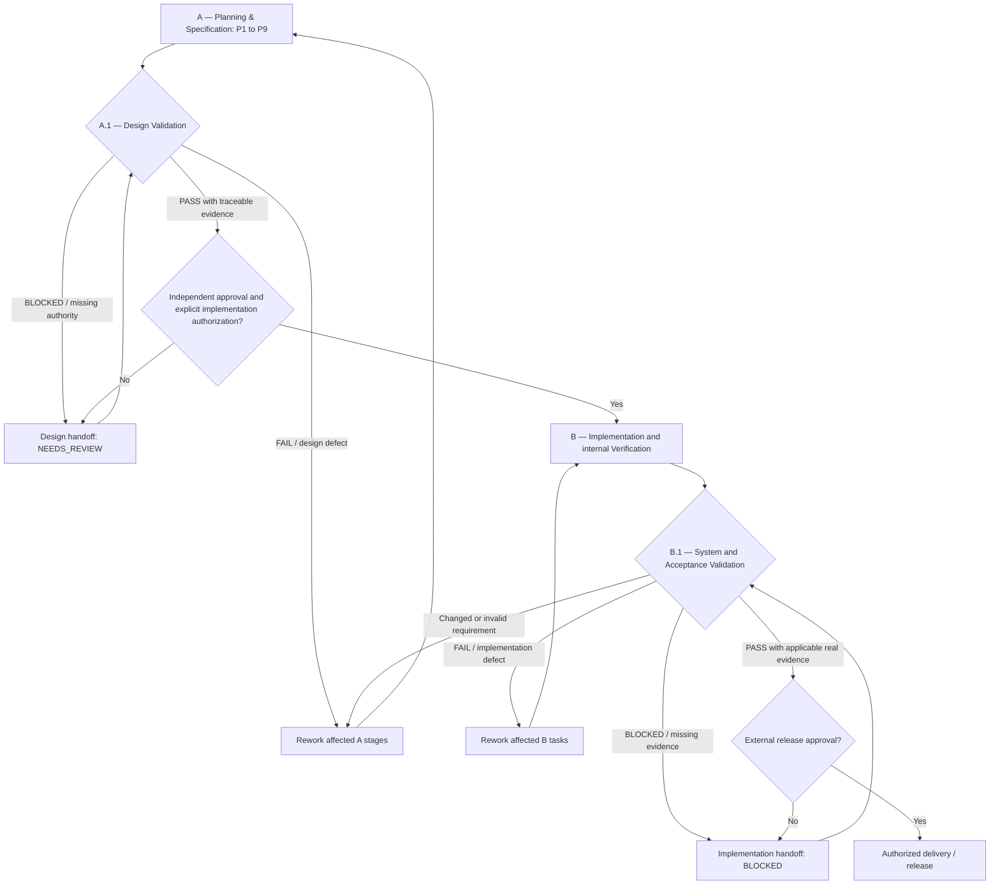

# Spec2Code — A.1 and B.1 Validation Specification (PLAN-085)

> **Proposed governance contract.** The current Spec2Code work is still **A — Planning & Specification** (`DESIGN_IN_PROGRESS`). This document defines **A.1** and **B.1** as review/validation loops; it does **not** execute them, introduce new Workflow Guard phases, authorize programming, or certify a release. For the detailed parent lifecycles see [A — Planning Workflow](planningSpecificationWorkflow.md), [B — Implementation Workflow](workflowSpecification.md), [system RTM](../.traceMatrix.md), [Risk Matrix](../.riskMatrix.md), and [handoff protocol](stopAndHandoff.md).

## 1. Four-loop lifecycle

A and B remain **different life cycles**, not two equivalent implementations. A.1 tests the correctness, completeness and readiness of the **design package**. B.1 validates the **actual resulting system in representative conditions**. Neither is equivalent to a local unit-test command or an agent assertion.

## 2. A.1 — Design Validation

**When:** after A's P1–P9 have produced a reviewable specification package and design handoff, **before** any new implementation authorization.

**Inputs:** SRS version, requirement/AC catalogue, [RTM](../.traceMatrix.md), research provenance/source authority, [feature designs](../.documents/featureDesign.md), architecture/workflow/STOP contracts, [scored risk matrix](../.riskMatrix.md), migration/security constraints, open decisions and the A-design handoff.

**Minimum validation matrix:**

| ID | Validation question and pass criterion | If failed |
| --- | --- | --- |
| `A1-VAL-01` Source authority | All normative requirements identify source owner, version, approval state and scoped applicability; disputed claims are not silently promoted | Return A/P2–P4; BLOCKED if owner absent |
| `A1-VAL-02` Requirements and AC | In-scope FR/NFRs are internally consistent, testable, scoped, prioritized and have measurable acceptance criteria | Return A/P4 |
| `A1-VAL-03` Bidirectional RTM | Every active feature/requirement maps to AC/design/test plan or explicit gap; no orphan requirement, stale reference or fabricated test | Return A/P4–P5 |
| `A1-VAL-04` Feature design | Main, alternate, error and STOP paths, input/output/data ownership, permissions and interfaces are compatible with requirements | Return A/P5 |
| `A1-VAL-05` Architecture and workflow | State transitions, integration/Spec Kit ownership, Path Guard boundary, session/handoff integrity, versioning and migration are designed consistently | Return A/P6 |
| `A1-VAL-06` Risk Discovery | Security, privacy, policy, data loss, OS, integration, testing, governance and recovery threat surfaces are considered, with ownership | Return A/P7 |
| `A1-VAL-07` Risk Management | Latest L×I scores and severity-ranked mitigation/expected residuals are recorded; highest unresolved risk addressed first; mandatory P0/P1 blockers disclosed | Return A/P8; BLOCKED on unaccepted critical risk |
| `A1-VAL-08` Design handoff | Exact source revisions, decisions, unresolved tasks, review owners, implementation backlog, verification approach and rollback are present | Return A/P9 |
| `A1-VAL-09` Independent signoff | Actual accountable reviewer decision recorded for the exact document revision and residual risk | PASS does not imply approval; remain NEEDS_REVIEW until signed |

**Result:** per-check `PASS | FAIL | BLOCKED | NOT_RUN | N/A` with source, reviewer and rationale; aggregate `A1_PASS` only if all **applicable** controls pass, no unaccepted blocking risk, and evidence is current. `NOT_RUN`, `BLOCKED` and unapproved required criteria prevent promotion. `N/A` needs a justified owner-approved applicability decision and is never a loophole for critical security controls.

A.1 `PASS` means the **design package met its defined checks**; it is still distinct from independent `APPROVED_FOR_IMPLEMENTATION` and a separately authorized code task. A.1 FAIL/BLOCKED requires a handoff specifying the exact A-stage(s) to revisit and impacted requirement/risk IDs; do not discard earlier review evidence.

**Present status:** `A1_NOT_RUN`. SRS approval, source authority and high-risk design remain incomplete. No A.1 validation has been performed simply by publishing this specification.

## 3. B.1 — System and Acceptance Validation

**When:** only after B has been separately authorized and implementation/in-team VERIFY evidence exists; perform before a production release or claim of full system acceptance.

**Inputs:** exact A.1-approved SRS/RTM/AC version and change log, implementation source SHA and diff, relevant policy/security contracts, build and CI evidence, representative host/test environment, actual test cases/logs, migration/recovery results, accepted and residual risk register, implementation handoff.

| ID | Validation question and pass criterion | If failed |
| --- | --- | --- |
| `B1-VAL-01` Baseline binding | Exact implemented SHA and deployed/tested artifact, host policy and approved requirement revision match the validation scope | BLOCKED; recapture source/evidence |
| `B1-VAL-02` Functional acceptance | Each required AC is exercised in relevant real user/agent scenarios, including positive/negative/error/STOP flows and boundary cases | B/IMPLEMENT rework |
| `B1-VAL-03` Integration and compatibility | Installed skill, optional Spec Kit bridge, dependency/environment and existing public CLI/JSON contracts work as designed | B rework, or A design revalidation if contract changed |
| `B1-VAL-04` Security and adversarial safety | Scope escapes, secrets, unowned files, authorization bypass and Windows path races receive specific adversarial evidence in supported environments | BLOCKED; B security fix plus independent review |
| `B1-VAL-05` Reliability, provenance and migration | Session restore, source drift invalidation, STOP/handoff/recovery, legacy migration and rollback demonstrate safe behavior for applicable approved scenarios | B rework or A design revision |
| `B1-VAL-06` Regression and platform matrix | Actual relevant tests on exact SHA are reported by environment and outcome, including SKIPPED/NOT RUN; required platform coverage completed | B/VERIFY rework |
| `B1-VAL-07` Risk re-assessment | Observed defects update the scored risk matrix; P0/P1 remain release blockers absent explicit independent acceptance | BLOCKED or return A/P8 if threat model changed |
| `B1-VAL-08` User and stakeholder validation | Actual authorized domain/host owners validate the accepted use cases and decision/approval boundary | NEEDS_REVIEW; stakeholder decision |
| `B1-VAL-09` Release handoff | Exact evidence, unresolved defects, residual risks, compatibility, rollback and release decision owner recorded | BLOCKED if incomplete |

**Result:** `B1_PASS` only after all applicable checks are genuinely evidenced; a green unit-test/CI result alone satisfies **none** of the missing host/security/stakeholder checks. `B1_FAIL` returns to B for a code/verification issue, or to A (and then A.1) for a changed requirement or defective design. `B1_BLOCKED` requires a bounded handoff and no release action. `B1_NOT_RUN` is the current truthful state.

Passing B.1 does **not** self-authorize Git merge, deployment, production release or policy overrides; those require a distinct, explicit external decision.

## 4. Verification vs Validation and ownership

- **B/VERIFY** asks whether the implementation passed its internal build, tests and code-level checks at an observed SHA: *Did we build it according to the specification?*
- **A.1** asks whether the *specification and design itself* is coherent, reviewable, safe, sourced and testable: *Is the proposed system specified correctly?*
- **B.1** asks whether the integrated implementation meets approved requirements in representative host/user/security scenarios: *Does the delivered system satisfy the intended need and contract?*

A design author may prepare evidence for A.1 but does not independently approve the same design. An implementation author may run tests for B.1 but cannot self-approve host business/security or release decisions. When independent reviewers are unavailable, report `NEEDS_REVIEW`, not invented approval.

## 5. Validation artifact, traceability and repeatability

Use [Validation Report Template](validationReportTemplate.md); maintain `VAL-A1-<task/revision>` or `VAL-B1-<task/revision>` as a unique report identifier. Store a new report at a **reviewed, non-overwriting Markdown path** only when file write is authorized, otherwise provide a safe in-chat `NOT_PERSISTED` report. Record actual check status, requirement/AC, evidence location/ref/SHA, reviewer, risk, defects and next action.

Each A.1/B.1 cycle must: (a) re-read current source revisions and prior findings, (b) update [RTM](../.traceMatrix.md) and [Risk Matrix](../.riskMatrix.md), (c) prioritize highest currently unresolved risk, (d) retain failures with a change/fix history, (e) re-run **affected** checks after changes; do not silently reuse old PASS. Do not run B.1 or create synthetic test outcomes during the current planning-only work.

## 6. Change and compatibility boundary

`A.1` and `B.1` are **human-directed validation subprocesses**, *not* new machine phases or values in `.source/.config/workflow.json`. No runtime `workflow_guard.py` actions, event schema, persistent new state, Python, CI or host deployment were changed by PLAN-085. Future automation requires separate approved requirements, compatibility migration, tests and adversarial review.

**Current overall disposition:** A = `DESIGN_IN_PROGRESS`; A.1 = `NOT_RUN`; B = `NOT_AUTHORIZED / NOT_STARTED`; B.1 = `NOT_RUN`.

## 7. PLAN-086: A.1/B.1 review of default version and user override

**A.1** must apply the [cross-stack technology/structure policy](../.documents/technologyVersionPolicy.md) and check [technology assessment](../.documents/technologyAssessmentTemplate.md) during `A1-VAL-01`, `A1-VAL-05` and `A1-VAL-07`: genuine vendor support/EOL, maturity and mainstream adoption, actual Python/PowerShell/DBMS/.NET compatibility, tested/common project layout, risk ownership and host policy. If a user explicitly selected a **newly GA but supported stable major**, use an [override record](../.documents/technologyOverrideTemplate.md) to accept it as a **design preference** with disclosed risk rather than silently replacing it. Unsupported/EOL, preview or hazardous exceptions must not evade security/ownership approvals. Missing support or scope evidence → `FAIL/BLOCKED` and return to A.

**B.1**, only after separately authorized B, validates **effective actual versions** in both S2C tools/runtime (when affected) and target hosts: Python interpreters/wheels, `pwsh` edition/module dependencies, named SQL server/driver/dialect/migration, .NET runtime/SDK, OS/CI and architecture against the approved `TECH-ID/OVR-ID`, under `B1-VAL-01/03/04/06`. A supported major chosen by override is **not** exempt from real compatibility/regression/security evidence. No A.1 or B.1 has run; this is design guidance only and does not add runtime stages.

## 8. PLAN-088 — Independent review-service validation (design only)

For BR-017..021 (proposed S2C-REQ-038..042, F38..42), A.1 additionally checks assignment feasibility (required domain+QA/security), weights and budget, source/policy snapshot, independent worker evidence contract, synthesis dissent/P0 preservation, redaction/connector/Path Guard boundaries, STOP/RESUME provenance, compatibility and operator escalation. Evidence must cite AC-REV-01..09 from the [master plan](../.spec.md#13-one-consolidated-dependency-plan-plan-088-maps-into-m0m5). An author or generated persona cannot impersonate an independent authorized A.1 reviewer.

Future B.1 additionally requires real host-supported worker/sequential execution evidence; domain-mixed fixtures (software/data/BRD), n=1 and unavailable roles, quota/timeout, malicious source, stale revision, minority blocker, corrupted/partial reports and safe recovery; exact commit/config/host/OS/budget; regression results on approved source and actual independent signoff. Distinguish `INCONCLUSIVE` review recommendation from A.1/B.1 validation outcomes. Missing evidence = NOT_RUN/BLOCKED, never PASS.

No change to the five machine runtime phases, host permissions or existing A.1/B.1 approval authority is made here. Status at this revision: BR-017..021 DESIGN_PROPOSED, A.1 NOT_RUN, B NOT_AUTHORIZED, B.1 NOT_RUN.

## 9. PLAN-102 — Independent A.1 review packet and criteria

**Source of truth:** [master Section 27](../.spec.md#27-plan-102--documentation-authoring-closure-and-bounded-implementation-blueprint), [RTM](../.traceMatrix.md#t-plan-102--gate-to-implementation-trace), [risks](../.riskMatrix.md#22-plan-102--risk-disposition-priority-and-handoff), and [design ADRs](../.documents/featureDesign.md#10-plan-102--architecture-decision-records-for-a1-disposition). This is an **author-prepared evidence index**, not a scored external A.1 review. Reviewer name/authority/signature **UNKNOWN**; every formal A1-VAL outcome remains `NOT_RUN`.

| Gate | Required evidence and reviewer assertion | Author-preflight finding | Formal reviewer |
| --- | --- | --- | --- |
| A1-VAL-01 Authority | Exact Git SHA and Google doc/tab/revision, accepted BRD semantics, accountable approvers | Git/Google revision pair exists; mirror had PLAN-098..101 gap; owner approval unknown | NOT_RUN |
| A1-VAL-02 Requirement testability | Each active BR/REQ, actor/precondition, positive/negative AC and ambiguous default disposition | SRS-01..12 drafted; BR-022..027 candidate, F43..64 not approved | NOT_RUN |
| A1-VAL-03 Bidirectional trace | Requirement → feature → task → test → risk/evidence and reverse; no orphan identifiers | Candidate RTM covers 44 F cases and 12 MM test IDs; execution NOT_RUN | NOT_RUN |
| A1-VAL-04 Scope and workflow | Architecture layers, source owner, five machine phases vs nine work stages, STOP/RESUME and Spec Kit source | Contracts described; native mutation and real resume unverified | NOT_RUN |
| A1-VAL-05 Security/integration | Path Guard Windows/OneDrive/junction threat model, env overrides, provider secrets, independent OS sandbox | Known P0 and CLI state failures; no hostile-host test | NOT_RUN |
| A1-VAL-06 Risk controls | Highest P0 grouped by cause, treatment owner, residual risk, negative tests and rollback | Risks scored; mitigations not empirically closed | NOT_RUN |
| A1-VAL-07 Independent validation plan | Case IDs, fixtures, OS/runtime/metrics, fail conditions, external sentinels and CI evidence | Planned catalogue; actual MM/L1 host cases NOT_RUN | NOT_RUN |
| A1-VAL-08 Handoff provenance | Diff, exact source/CI refs, preexisting local changes, restart and rollback | GitHub checkpoints present; no fresh local git status | NOT_RUN |
| A1-VAL-09 Approval and decision | Named independent reviewer, signed findings, accepted exceptions, owner risk/BRD decisions | No reviewer signature, approval or accepted P0 waiver | NOT_RUN |

**Required review result envelope:** `reviewId, reviewerIdentity, authorityEvidence, gitSha, googleDocId, googleTabId, googleRevision, requirementScope, A1-VAL-01..09 dispositions(PASS|FAIL|BLOCKED|NOT_RUN), ADR decisions, P0 risks, dissent, evidenceLinks, reviewedAt, signatureRef, nextActions`. Only an authorized real reviewer may create a formal decision; an agent cannot backfill identity or sign on behalf of a reviewer. A.1 PASS requires all mandatory applicable checks PASS with evidence, plus separate owner dispositions for blocking requirements/risks. Any unreviewed mandatory case => A1_BLOCKED/NOT_RUN. A.1 does not itself authorize B.

**Candidate authoring exit:** content cross-references, explicit owner queue and static ID/link checks may be `AUTHORING_COMPLETE_CANDIDATE` while formal A.1 remains NOT_RUN. A review outcome must be source-pair stable: if Git SHA or Google revision changes materially, re-evaluate impacted A.1 gates instead of reusing a prior signature.

### 9.1 Source-pair update after PLAN-102 draft mirror append

For a future independent A.1, start from Git **output SHA containing the [final checkpoint](../.handoffs/plan-102-documentation-checkpoint-6.md)**, not the prior input SHA, and Google `BRD_Spec2Code` tab `t.0` revision `AHj4eMQimSgt3E4kP8uig3zv8Q17mG5pt07xMNpj8odRfcWIbWyujdly0nTK1zFCwwC0sk4SNMvBMMyTrKR8sGWDzNtgFpQvC7j_fF0PeA` (or a newer verified revision). Sections 31–35 are now present in the draft mirror; **business-level equivalence and approval remain pending**. Therefore A1-VAL-01 and A1-VAL-09, and the formal A.1 as a whole, remain `NOT_RUN`. The previous evidence that Google lacked those headings at its former revision is historical and must not be misreported as current.
