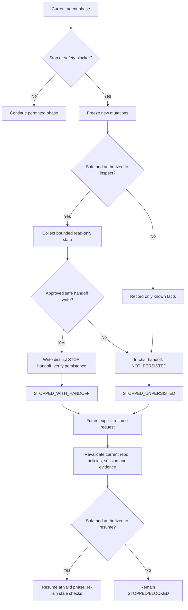

# Spec2Code — Workflow Specification v0.8 candidate

> **Current baseline: PLAN-087 / BRD v1.2.** Start with [the unified BRD, architecture and M0–M5 implementation plan](../.spec.md). Detailed and historical sections below are supporting references; they do not supersede current scope, evidence or lifecycle mapping.

> **Specification**, not evidence that all runtime transitions work. Source owner: Spec2Code development governance. Effective only when adopted by the interactive ChatGPT/Codex agent and permitted by the selected Git worktree/host. Implementation references: `.source/scripts/workflow_guard.py`, `.source/scripts/session_guard.py`, `.source/scripts/handoff_store.py`, `.source/.config/workflow.json`, `.source/.config/handoff.json`. See [STOP and handoff protocol](stopAndHandoff.md), [agent runbook](agentRunbook.md), [RTM](../.traceMatrix.md), [testing gates](testingAndDelivery.md).

## 1. Objective, actors and bounded authority

Ensure every task has a single understood scope, a verified requirements owner, traceable state and evidence, the ability to **STOP safely**, and a handoff that allows another agent/human to resume after revalidation.

Actors: requester (scope/authorization), interactive agent (reads, assists and records when authorized), host policy/requirement owner (domain decisions), test executor (observed validation), independent reviewer (acceptance), local S2C utilities (preflight/provenance only). None is created automatically by writing this specification. A machine `READY` status is not business approval or release authorization.

Each task must have a stable task ID; actual task description; verified target repository/ref; scoped affected paths; consulted AGENTS/policy and requirements; work authorization; session ID if local runtime started; phase; evidence and outstanding gates. Unknown details are `UNKNOWN`, not invented.

## 2. Normal five-stage agent lifecycle

| Phase | Required entry evidence | Permitted work | Exit criteria | Failure response |
| --- | --- | --- | --- | --- |
| **DISCOVER** | Actual repo/ref; known read permission | Identify root/nested AGENTS, requirements, source layout, task boundaries, optional Spec Kit feature | Sources and conflicting authorities identified; scope accurate | STOP if unsafe root, unreadable authority or ownership conflict |
| **SPECIFY_PLAN** | Discovery evidence | Requirements, AC IDs, plan, dependencies, risk, authority decisions, relevant Spec Kit specs/plan/tasks | No unapproved requirement/security blocker; affected paths and test strategy recorded | NEEDS_REVIEW or STOP with unresolved decision |
| **IMPLEMENT** | Explicit write permission and guarded active session where applicable | Edit approved in-scope code; preserve existing work and record self-authored paths | Changes attributable; new scope/policy reviewed | STOP, or explicit return to plan on scope change |
| **VERIFY** | Known revision and changed source paths | Run authorized build/lint/tests; record actual outcomes, test IDs and skipped cases | Acceptance evidence current for exact source/requirement revision | FAIL returns to IMPLEMENT via explicit review, or STOP |
| **HANDOFF_REVIEW** | Revision-specific trace and outstanding risk list | Prepare completion handoff and request independent review | Only externally authorized close/merge/release | STOP with handoff and missing decision — never self-approve |

Normal phase graph: `DISCOVER → SPECIFY_PLAN → IMPLEMENT → VERIFY → HANDOFF_REVIEW`. Rework is permitted only by explicitly recorded, policy-consistent transitions. A changed authoritative requirement, source, task scope or Spec Kit artifact invalidates impacted prior evidence; do not reuse a previous PASS.

**Machine implementation today:** `workflow_guard.py` has `begin`, `advance`, `invalidate`, `reconcile`, `close` and read-only `status/evaluate`, with five fixed phases and statuses `PENDING/IN_PROGRESS/READY/NEEDS_REVIEW/BLOCKED/COMPLETE/INVALIDATED`. It has **no PAUSED status, STOP action or RESUME action**. Three P0 plus one P1 correctness findings in PR #7 must be repaired separately. These agent operating instructions do **not** alter the machine journal.

## 3. Interruptible STOP path — applicable in every phase

`STOP` is a **request/agent behavior**, orthogonal to the five phases. It does not mean `COMPLETE`, `INVALIDATED`, or a closed session.

STOP triggers: requester says stop/pause/handoff; loss of permission; missing/contradicting approved source; path/scope/secret/collision anomaly; source drift or session mismatch; failed validation; tool outage; change in Spec Kit feature; token/context/time limit; unsafe destructive action; unexpected interruption. For an unexpected crash with no verified handoff, state is `INTERRUPTED_UNKNOWN`, not `STOPPED_WITH_HANDOFF`.

## 4. STOP contract and required output

An agent MUST:

1. **Immediately stop further implementation, tests that mutate state, Git writes and external operations** at the next safe boundary. If an operation is already running and cannot be interrupted, disclose uncertainty rather than claiming rollback.
2. Preserve observed user work; do not clean/reset/stash, delete files, finish an ACTIVE session, merge its handoff ledger, close the workflow, or invent permissions. An optional `checkpoint` is a state-mutating command; run it only in a previously validated, authorized local session where the relevant paths are safe.
3. Capture bounded facts: exact task and reference, last phase, STOP reason, current workflow/session status *as observed*, changed/uncommitted paths and their attribution, source/spec revisions, completed/pending AC/task IDs, checks actually run with results, test skips, blockers, outstanding approvals, risks/rollback and next safe step.
4. Produce a human-readable STOP handoff from [template](../../.source/references/stop-handoff-template.md). For an authorized safe write, persist it under a new, non-overwriting host-approved path (suggestion `.agents/.handoffs/.stops/<task-id>/<UTC-timestamp>.md`). That path is **not automatically created by today's runtime** and must pass path/ownership preflight. It must never collide with machine `.details/.visualChange.*`, `.details/.specChange.*` or `.buildnotes.handoff.md`.
5. Always return the compact handoff in chat as well. If persistence is denied, uncertain or fails, mark `NOT_PERSISTED` with the reason; do not claim a file or a checkpoint exists. A successful write needs verification against the exact destination.
6. Leave the current machine session and workflow state as they actually are. The *agent-level* result is `STOPPED_WITH_HANDOFF`, `STOPPED_UNPERSISTED` or `INTERRUPTED_UNKNOWN`; these are reporting outcomes **not** new `.config/workflow.json` values.

The [STOP protocol](stopAndHandoff.md) defines exact fields, replay protection, multiple-stop behavior and recovery.

## 5. Resume contract — explicitly requested and revalidated

A subsequent agent may resume only after identifying the correct handoff/task/ref and re-reading the **current**, not historical, root/nested AGENTS, current requirements and current source. It must revalidate physical checkout and in-scope paths, identify active session ownership and drift, compare current HEAD/working tree/spec hashes to recorded evidence, revisit decisions/approvals, and re-run impacted tests or plans. It may continue the existing ACTIVE session if safely bound; it must not create a second ACTIVE session or assume handoff ownership permits writes.

If current inputs changed, mark affected prior tests and approvals **STALE/NOT VERIFIED** and return to the earliest impacted phase. If missing a trusted approval, stop at NEEDS_REVIEW. An invalid/foreign/contradictory handoff is evidence to investigate, not authorization. Git commit, push, merge and release are always separately authorized.

## 6. Acceptance criteria and trace

- `S2C-REQ-037` / `S2C-AC-037`: any phase can be interrupted without falsely marking COMPLETE, and a minimal handoff is emitted with persistence status. **Agent Markdown specified; runtime STOP/RESUME not implemented.**
- `S2C-NFR-007` / `S2C-NAC-007`: the resume gate must reject stale/foreign checkout, unapproved source, missing approvals and stale test evidence. **Not validated by a machine integration test yet.**
- `S2C-REQ-030` / `S2C-NFR-006`: underlying Workflow Guard integrity defects remain release-blocking. A STOP handoff is **not a fix** for their state transitions.
- Intended future tests (not currently present): safe STOP at all five phases, user-requested STOP during IMPLEMENT, failed-test STOP, unauthorized handoff-write failure, repeated STOP without overwrite, checksum verification, interrupted/no file, resumed drift requiring new authorization, and rejecting close/merge on STOP.

## 7. Evidence and change control

When implementation changes: update [system spec](../.spec.md), [feature register](../.features.md), [RTM](../.traceMatrix.md), plan/risk, tests and an exact-session handoff. Do not introduce a `PAUSED` enum or a new workflow event without a reviewed schema migration, replay compatibility, new negative tests and explicit user approval. Host installations must not rewrite existing AGENTS, Spec Kit artifacts, runtime state or prior handoffs.

## 8. External B.1 acceptance validation after B (PLAN-085)

This document describes the future **B implementation lifecycle**, including its internal VERIFY phase. Once implementation is authorized and complete, the separately specified [B.1 System and Acceptance Validation](validationSpecification.md) is still required before any claim of integrated system acceptance or release. B.1 checks actual approved user/host scenarios, security/adversarial/path safety, Windows and migration applicability, integration, recovery, source/requirement version matching and independent acceptance using a [validation report](validationReportTemplate.md).

- **B/VERIFY** is internal test/build and scope evidence; **B.1** is stakeholder/system validation. Passing the former does not satisfy the latter.
- `B1_FAIL` returns to affected B implementation/tests, or to A/A.1 if the specification/design changed. `B1_BLOCKED` stops release and creates a handoff. `B1_PASS` requires real evidence but **still does not authorize Git merge/deploy**.
- No B.1 is currently running, and neither A.1 nor B.1 is a machine phase in `.source/.config/workflow.json`.
