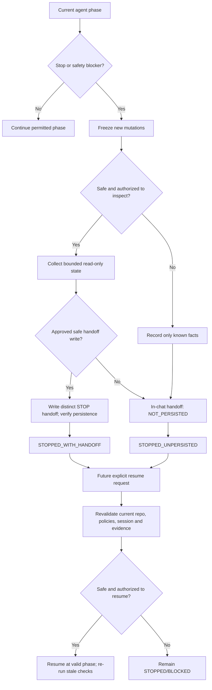

# Spec2Code — Workflow Specification v0.8 candidate

> **Current baseline: PLAN-092 / unified BRD/SRS v1.5 + Spec Kit bootstrap (PLAN-087..091 retained).** Start with [the unified BRD, architecture and M0–M5 implementation plan](../.spec.md). Detailed and historical sections below are supporting references; they do not supersede current scope, evidence or lifecycle mapping.

> **Specification**, not evidence that all runtime transitions work. Source owner: Spec2Code development governance. Effective only when adopted by the interactive ChatGPT/Codex agent and permitted by the selected Git worktree/host. Implementation references: `.source/scripts/workflow_guard.py`, `.source/scripts/session_guard.py`, `.source/scripts/handoff_store.py`, `.source/.config/workflow.json`, `.source/.config/handoff.json`. See [STOP and handoff protocol](stopAndHandoff.md), [agent runbook](agentRunbook.md), [RTM](../.traceMatrix.md), [testing gates](testingAndDelivery.md).

## 1. Objective, actors and bounded authority

Ensure every task has a single understood scope, a verified requirements owner, traceable state and evidence, the ability to **STOP safely**, and a handoff that allows another agent/human to resume after revalidation.

Actors: requester (scope/authorization), interactive agent (reads, assists and records when authorized), host policy/requirement owner (domain decisions), test executor (observed validation), independent reviewer (acceptance), local S2C utilities (preflight/provenance only). None is created automatically by writing this specification. A machine `READY` status is not business approval or release authorization.

Each task must have a stable task ID; actual task description; verified target repository/ref; scoped affected paths; consulted AGENTS/policy and requirements; work authorization; session ID if local runtime started; phase; evidence and outstanding gates. Unknown details are `UNKNOWN`, not invented.

## 2. Universal nine-stage execution contract (PLAN-098)

**Every phase and every task** (A, A.1, B, B.1, release, maintenance and later F64) must record all nine stages with `taskId, phase, stage, input/sourceSHA, expectedOutput, actualOutput, riskIds, evidence, status, ownerRole, nextAction`. A missing tool is `NOT_RUN`, never PASS. A particular tool check can be `NOT_APPLICABLE` with reason, but the stage itself cannot vanish. IMPLEMENT means producing the phase-appropriate artifact; A planning documents do not authorize B source edits.

| Universal stage | Minimum input → output / failure path |
| --- | --- |
| DISCOVER | Actual repository/ref, AGENTS, source/authority → scoped inventory; unknown root/owner blocks |
| PLAN | Scope → acceptance criteria, expected output, dependency and resource/test plan |
| RISK MANAGEMENT | Plan and evidence → discovered/scored risks, highest-risk mitigation and blocker disposition |
| IMPLEMENT | Approved action → only phase-appropriate scoped artifact with provenance |
| TEST | Artifact → static/doc/build/security/mutation test evidence when applicable |
| VERIFY | Observed result vs AC, source freshness and required independent approval |
| OPTIMIZE | Baseline → bounded change or `NO_CHANGE`; re-TEST/VERIFY if changed, reassess risk |
| HANDOFF | STOP-safe snapshot, risks, result/next owner and PERSISTED/NOT_PERSISTED |
| DOCUMENT | Sync canonical BRD/RTM/feature/risk/decision records and final handoff links |

**Static verification:** informal review, walkthrough, technical review and inspection are different review evidence levels; coding conventions, control/data flow, unreachable code, complexity, security and dependencies are static-analysis checks. Proposed F38–F42 worker reviews reuse frozen source and independent findings where actually available; one-model sequential lenses are **not** independently executed workers.

**Fail-safe:** stop unsafe operations, do not silently reauthorize, preserve evidence, bound attempts and resources, record blocked status and handoff. External A.1/B.1 approval cannot be replaced with a model score. F64 proposal requires externally immutable Z0/Z1 Protected Core, >95% completeness and scoped line+branch coverage, 100% mandatory acceptance criteria, no mandatory security blocker and human merge. Existing five machine phases remain unchanged.

## 3. Normal five-stage machine lifecycle (unchanged)

| Phase | Required entry evidence | Permitted work | Exit criteria | Failure response |
| --- | --- | --- | --- | --- |
| **DISCOVER** | Actual repo/ref; known read permission | Identify root/nested AGENTS, requirements, source layout, task boundaries, optional Spec Kit feature | Sources and conflicting authorities identified; scope accurate | STOP if unsafe root, unreadable authority or ownership conflict |
| **SPECIFY_PLAN** | Discovery evidence | Requirements, AC IDs, plan, dependencies, risk, authority decisions, relevant Spec Kit specs/plan/tasks | No unapproved requirement/security blocker; affected paths and test strategy recorded | NEEDS_REVIEW or STOP with unresolved decision |
| **IMPLEMENT** | Explicit write permission and guarded active session where applicable | Edit approved in-scope code; preserve existing work and record self-authored paths | Changes attributable; new scope/policy reviewed | STOP, or explicit return to plan on scope change |
| **VERIFY** | Known revision and changed source paths | Run authorized build/lint/tests; record actual outcomes, test IDs and skipped cases | Acceptance evidence current for exact source/requirement revision | FAIL returns to IMPLEMENT via explicit review, or STOP |
| **HANDOFF_REVIEW** | Revision-specific trace and outstanding risk list | Prepare completion handoff and request independent review | Only externally authorized close/merge/release | STOP with handoff and missing decision — never self-approve |

Normal phase graph: `DISCOVER → SPECIFY_PLAN → IMPLEMENT → VERIFY → HANDOFF_REVIEW`. Rework is permitted only by explicitly recorded, policy-consistent transitions. A changed authoritative requirement, source, task scope or Spec Kit artifact invalidates impacted prior evidence; do not reuse a previous PASS.

**Machine implementation today:** `workflow_guard.py` has `begin`, `advance`, `invalidate`, `reconcile`, `close` and read-only `status/evaluate`, with five fixed phases and statuses `PENDING/IN_PROGRESS/READY/NEEDS_REVIEW/BLOCKED/COMPLETE/INVALIDATED`. It has **no PAUSED status, STOP action or RESUME action**. Three P0 plus one P1 correctness findings in PR #7 must be repaired separately. These agent operating instructions do **not** alter the machine journal.

## 4. Interruptible STOP path — applicable in every phase

`STOP` is a **request/agent behavior**, orthogonal to the five phases. It does not mean `COMPLETE`, `INVALIDATED`, or a closed session.

STOP triggers: requester says stop/pause/handoff; loss of permission; missing/contradicting approved source; path/scope/secret/collision anomaly; source drift or session mismatch; failed validation; tool outage; change in Spec Kit feature; token/context/time limit; unsafe destructive action; unexpected interruption. For an unexpected crash with no verified handoff, state is `INTERRUPTED_UNKNOWN`, not `STOPPED_WITH_HANDOFF`.

## 5. STOP contract and required output

An agent MUST:

1. **Immediately stop further implementation, tests that mutate state, Git writes and external operations** at the next safe boundary. If an operation is already running and cannot be interrupted, disclose uncertainty rather than claiming rollback.
2. Preserve observed user work; do not clean/reset/stash, delete files, finish an ACTIVE session, merge its handoff ledger, close the workflow, or invent permissions. An optional `checkpoint` is a state-mutating command; run it only in a previously validated, authorized local session where the relevant paths are safe.
3. Capture bounded facts: exact task and reference, last phase, STOP reason, current workflow/session status *as observed*, changed/uncommitted paths and their attribution, source/spec revisions, completed/pending AC/task IDs, checks actually run with results, test skips, blockers, outstanding approvals, risks/rollback and next safe step.
4. Produce a human-readable STOP handoff from [template](../../.source/references/stop-handoff-template.md). For an authorized safe write, persist it under a new, non-overwriting host-approved path (suggestion `.agents/.handoffs/.stops/<task-id>/<UTC-timestamp>.md`). That path is **not automatically created by today's runtime** and must pass path/ownership preflight. It must never collide with machine `.details/.visualChange.*`, `.details/.specChange.*` or `.buildnotes.handoff.md`.
5. Always return the compact handoff in chat as well. If persistence is denied, uncertain or fails, mark `NOT_PERSISTED` with the reason; do not claim a file or a checkpoint exists. A successful write needs verification against the exact destination.
6. Leave the current machine session and workflow state as they actually are. The *agent-level* result is `STOPPED_WITH_HANDOFF`, `STOPPED_UNPERSISTED` or `INTERRUPTED_UNKNOWN`; these are reporting outcomes **not** new `.config/workflow.json` values.

The [STOP protocol](stopAndHandoff.md) defines exact fields, replay protection, multiple-stop behavior and recovery.

## 6. Resume contract — explicitly requested and revalidated

A subsequent agent may resume only after identifying the correct handoff/task/ref and re-reading the **current**, not historical, root/nested AGENTS, current requirements and current source. It must revalidate physical checkout and in-scope paths, identify active session ownership and drift, compare current HEAD/working tree/spec hashes to recorded evidence, revisit decisions/approvals, and re-run impacted tests or plans. It may continue the existing ACTIVE session if safely bound; it must not create a second ACTIVE session or assume handoff ownership permits writes.

If current inputs changed, mark affected prior tests and approvals **STALE/NOT VERIFIED** and return to the earliest impacted phase. If missing a trusted approval, stop at NEEDS_REVIEW. An invalid/foreign/contradictory handoff is evidence to investigate, not authorization. Git commit, push, merge and release are always separately authorized.

## 7. Acceptance criteria and trace

- `S2C-REQ-037` / `S2C-AC-037`: any phase can be interrupted without falsely marking COMPLETE, and a minimal handoff is emitted with persistence status. **Agent Markdown specified; runtime STOP/RESUME not implemented.**
- `S2C-NFR-007` / `S2C-NAC-007`: the resume gate must reject stale/foreign checkout, unapproved source, missing approvals and stale test evidence. **Not validated by a machine integration test yet.**
- `S2C-REQ-030` / `S2C-NFR-006`: underlying Workflow Guard integrity defects remain release-blocking. A STOP handoff is **not a fix** for their state transitions.
- Intended future tests (not currently present): safe STOP at all five phases, user-requested STOP during IMPLEMENT, failed-test STOP, unauthorized handoff-write failure, repeated STOP without overwrite, checksum verification, interrupted/no file, resumed drift requiring new authorization, and rejecting close/merge on STOP.

## 8. Evidence and change control

When implementation changes: update [system spec](../.spec.md), [feature register](../.features.md), [RTM](../.traceMatrix.md), plan/risk, tests and an exact-session handoff. Do not introduce a `PAUSED` enum or a new workflow event without a reviewed schema migration, replay compatibility, new negative tests and explicit user approval. Host installations must not rewrite existing AGENTS, Spec Kit artifacts, runtime state or prior handoffs.

## 9. External B.1 acceptance validation after B (PLAN-085)

This document describes the future **B implementation lifecycle**, including its internal VERIFY phase. Once implementation is authorized and complete, the separately specified [B.1 System and Acceptance Validation](validationSpecification.md) is still required before any claim of integrated system acceptance or release. B.1 checks actual approved user/host scenarios, security/adversarial/path safety, Windows and migration applicability, integration, recovery, source/requirement version matching and independent acceptance using a [validation report](validationReportTemplate.md).

- **B/VERIFY** is internal test/build and scope evidence; **B.1** is stakeholder/system validation. Passing the former does not satisfy the latter.
- `B1_FAIL` returns to affected B implementation/tests, or to A/A.1 if the specification/design changed. `B1_BLOCKED` stops release and creates a handoff. `B1_PASS` requires real evidence but **still does not authorize Git merge/deploy**.
- No B.1 is currently running, and neither A.1 nor B.1 is a machine phase in `.source/.config/workflow.json`.

## 10. PLAN-099 — Concurrency policy across mandatory nine-stage tasks

Parallelism may exist **inside** a phase (independent work units) or **between unrelated tasks in the same ready dependency wave**, but each individual task still completes all nine universal stages with evidence. Never parallelize an approval decision with a write that depends on that approval. Use the [construction-layer roadmap](../.spec.md#24-plan-099--construction-layer-roadmap-and-bounded-parallel-execution) and [DAG contracts](../.documents/featureDesign.md#81-bounded-parallel-work-and-worker-compatibility). This is a **design protocol**, not implemented threading or autonomous agent execution.

**Dispatch preflight:** source and host policy revision current; all prerequisite units verified; read/write/impact sets and Z0–Z4 approved; direct and indirect write collisions absent; capability, deadline, max workers and token/CPU/memory/CI budgets within host policy; retry bound and cancellation supported; independent reviewer roles available or transparently `SEQUENTIAL_NONINDEPENDENT`. A task cannot acquire more authority by becoming a worker.

**Execution barrier:** only one trusted integrator applies reviewed patches to a stable baseline, records changed source/hash, invalidates dependent cached evidence and reruns affected and mandatory regression/negative checks. Failure/timeout/drift/P0 requires cancellation of dependent nodes, no speculative release or cleanup, and a STOP-safe evidence handoff. Contended shared documents, Path Guard, trusted policies and workflow journal use a **single write owner**, with parallel read-only reviews allowed. No new runtime phase, active daemon, Git branch-per-worker or automatic PR merge is introduced.

**Validation:** compare serial versus bounded parallel runs for identical input and expected output: correctness/AC, source/review independence, runtime, token+CI costs, collision and fail-safe recovery. Until witnessed on an exact revision, report `NOT_RUN` and retain serial mode as a safe fallback where permissible.

## 11. PLAN-100 — Implementation evidence gate and failure precedence

Keep PLAN-099 concurrency a scheduler *inside* the universal nine-stage contract, not an independent lifecycle. The [L0/A.1 readiness ledger](../.plans.md#plan-100--l0-readiness-execution-and-b-gated-implementation-plan) and [L1 negative tests](testingAndDelivery.md#plan-100--l0-evidence-and-l1-bounded-securityworkflow-regression-specification) are the one implementation/verification route. This author-side preflight is not a certified A.1 report. **P0 path/policy/owner failures veto concurrency, quality score and stage closure.**

On source/policy/Spec Kit drift, worker loss, invalid scope, test failure, missing signer or unknown write provenance, stop the affected DAG, retain original immutable evidence and create an auditable HANDOFF; DOCUMENT never retroactively invents a PASS. Runtime `workflow_guard.py` still has five phases and known defects; no new statuses, schema migration or native `PAUSED` are introduced by these Markdown rules.

## DOC-B02 — Nine work stages versus five runtime phases

The **nine universal per-task stages** are DISCOVER, PLAN, RISK MANAGEMENT, IMPLEMENT, TEST, VERIFY, OPTIMIZE, HANDOFF, DOCUMENT. Risk Discovery is the separate **Phase-A P7 content substep** feeding RISK MANAGEMENT, not a tenth universal stage; HANDOFF and DOCUMENT remain distinct. These stages are documentation responsibilities, **not nine Workflow Guard enum states**. The runtime state model remains `DISCOVER → SPECIFY_PLAN → IMPLEMENT → VERIFY → HANDOFF_REVIEW`; evidence from several work stages can belong to a single machine phase, and authoring documents can be prepared without invoking the machine. The [planning workflow](planningSpecificationWorkflow.md) retains its separate nine-step Phase-A contract.

One task must declare both `workStage` and `runtimePhaseOrN_A` in its handoff. STOP/RESUME is an agent-level control path with exact source/policy revalidation, never an invented `PAUSED` enum or implicit `close`. Unknown source, unapproved implementation, unperformed required test or P0 veto prevents promotion regardless of how many work-stage boxes were completed. Any future schema/state migration is a separately approved Phase-B change with legacy journal recovery tests.

## Security-first development in Phase B

Apply this sequence to every S2C feature addition or modification in B, including each remediation attempt. The five existing agent phases and A → A.1 → B → B.1 retain their meanings. Complete the pre-write review matrix against the exact baseline and record changed paths, policy/Spec Kit references, applicable AC, risk IDs, owners, expected and failed results, verification plan and rollback. Start with the highest applicable security risk.

| Step / existing phase | Owner and action | Expected result | Failed or blocked result |
| --- | --- | --- | --- |
| 1. Security-first preflight / DISCOVER, SPECIFY_PLAN | GPTWEB can prepare the threat model and trace from pinned sources. CODEX verifies physical checkout, HEAD and worktree, root/nested AGENTS, approved paths and session binding where required. Confirm signed independent A.1, separate scoped B authority, testable AC, applicable Spec Kit gate, Path Guard and enforceable host containment. Assess secrets/data, authorization, dependency and scope-escape threats. Pin approved test groups and budgets before edits. | Current review matrix and bounded task with authorized paths, controls and evidence plan. | Missing authority, unresolved P0, unsafe scope/containment, collision or drift → STOP before code writes. |
| 2. Authorized code implementation / IMPLEMENT | CODEX applies the smallest approved change, preserving existing work. Recheck SHA, path ownership and allowed paths before each write batch. Record attributable diff and source/artifact digest for testing. | Reviewable patch within approved AC and scope, with rollback. | Unexpected path, changed scope or unsafe effect → STOP. An ordinary in-scope defect can be assessed in Revised. |
| 3. Independent security verification / VERIFY, HANDOFF_REVIEW | CODEX captures build, functional and security regression evidence, including applicable negative permission, scope-escape, adversarial host and rollback cases. An accountable reviewer independent of the patch author checks exact source/artifact, risk controls, measured groups and original results, and records an evidence-linked verdict. | All applicable mandatory cases evidenced, zero unresolved P0 and strict unrounded R > 99.99% in each mandatory measurable group. | Record FAIL, BLOCKED, NOT_RUN, INCONCLUSIVE or STALE as observed. Missing reviewer, evidence, coverage or measurement blocks advancement. A mandatory security violation triggers STOP. |
| 4. Revised / HANDOFF_REVIEW and authorized re-entry | Record finding, root cause, risk before/after, affected AC and tests, smallest remedy, owner and rollback. On successful verification record the disposition and hand off to independent B.1. | Current evidence and explicit disposition, with remaining tasks and next owner. | A recoverable code defect within unchanged approved scope returns to Step 1, then Steps 2–4. Changed requirements, architecture, trust boundaries or risk acceptance return to affected A stages, fresh A.1 and renewed scoped B approval before more implementation. |

Before the first write, pin a cumulative deadline and applicable execution/resource limits in the authorized task record. Allow at most **two remediation attempts after the initial implementation**, or fewer if the task budget specifies a tighter cap. Count each authorized re-entry for remediation when it starts. Keep earlier failures and attempt history across handoffs, retries and RESUME. Invalidate affected checks and independent review when relevant source, policy, fixture, host or artifact identity changes. Re-run impacted checks and obtain a fresh independent verdict on the new candidate. At the first budget limit, or if retries make no evidenced progress, STOP for owner disposition and return to A if the design or controls need revision. A new session or executor does not reset the budget.

For STOP, freeze new mutations and follow the [STOP protocol](stopAndHandoff.md). Capture the exact task, phase and step, baseline and candidate SHA/digest, paths, verified and stale evidence, risk/approval gaps, attempt count and limits, remaining tasks, next owner and safe action. Resume only on explicit request after revalidating authority, scope, evidence and remaining budget. Use [validation](validationSpecification.md) for the quality calculation and independent gates and the [runbook](agentRunbook.md#security-first-execution-and-checkpoints) for routing and checkpoints.

## PLAN-114 — Gemini reviewer attached to existing VERIFY checkpoint

Reuse **five existing machine phases**; do not add workflow enum, STOP status or hidden daemon.

| Phase | Codex responsibility | Optional reviewer |
| --- | --- | --- |
| DISCOVER / SPECIFY_PLAN | Approved AC, paths, host/security/data sharing, source & budget | Plan scope only; missing security owner or P0 blocks dispatch |
| IMPLEMENT | Sole approved writer, preserve file provenance | Never inspect mutable source snapshot |
| VERIFY | Run actual tests, mark taskComplete and freeze redacted immutable diff | A separately authorized OS-isolated worker may review once while Codex handles unrelated authorized work |
| HANDOFF_REVIEW | Validate findings, source freshness, risk/RTM and test evidence | No automatic acceptance, independent human gate remains required |

Future logical reviewer report values `REVIEW_NOT_DISPATCHED, REVIEW_BLOCKED, QUEUED, RUNNING, REVIEWED_NO_FINDINGS, FINDINGS, INCONCLUSIVE, STALE, CANCELED` are **not** Workflow Guard states. A Codex notify event may be used to propose checking task completion only when the installed Codex version advertises it; don't dispatch blindly per turn. No synchronous review on Codex's critical path. If source/policy/Spec Kit changes, invalidate the affected review; P0 blocks dependent acceptance. Apply bounded queue, concurrency=1, timeout/cancel/retry limits, exact-source handoff. [Runbook](agentRunbook.md#plan-114--codex-completion-and-gemini-review-protocol).

## PLAN-115 — Controlled VMware test-lab workflow (design)

This is an external test harness, **not** a new machine phase, activated daemon, source adapter or authorization. [Full command/VM runbook](../../docs/VMWARE_SECURITY_VALIDATION.md); [cases](testingAndDelivery.md#plan-115--vmware-host-and-command-case-matrix).

| Gate | Executor and requirement | Failure route |
| --- | --- | --- |
| VM-G0 | S2C verifies task ID, source SHA, owner, permitted effects/budget | Unknown task/authority → STOP |
| VM-G1 | Local controller discovers installed vmrun/version/help/signature/hash, approved VMX | Unknown/ambiguous binary or syntax → STOP |
| VM-G2 | Independent evaluator verifies guest/host isolation, actual ACL, protected canaries | Host shares/unenforced OS boundary → BLOCKED_HOST |
| VM-G3 | Owner pins disposable VM snapshot and fixture; preserves old evidence | No approved snapshot/ownership → STOP |
| VM-G4 | Bounded allowlisted synthetic L1-SC tests, single writer and cancellation | Any escape/P0/timeout → STOP, quarantine |
| VM-G5 | Evaluator captures OS audit, actual trigger, logs and canary evidence outside restore scope | Missing read proof/non-triggered race → INCONCLUSIVE |
| VM-G6 | Security Owner decides RM-001; independent A.1 reviewer uses exact Git/Google revisions | No self-approval; B not authorized |
| VM-G7 | Recover only after evidence preservation and owner-approved restore/quarantine | Never auto-delete unknown host/guest data |

Existing five Workflow Guard phases stay unchanged. Public-repository GitHub Actions remain ordinary hosted CI/mock tasks; a future separately approved outbound local controller is preferable to a public-repo privileged self-hosted shell runner. Gemini reads only redacted evidence after OS isolation, cannot launch vmrun or sign A.1.
